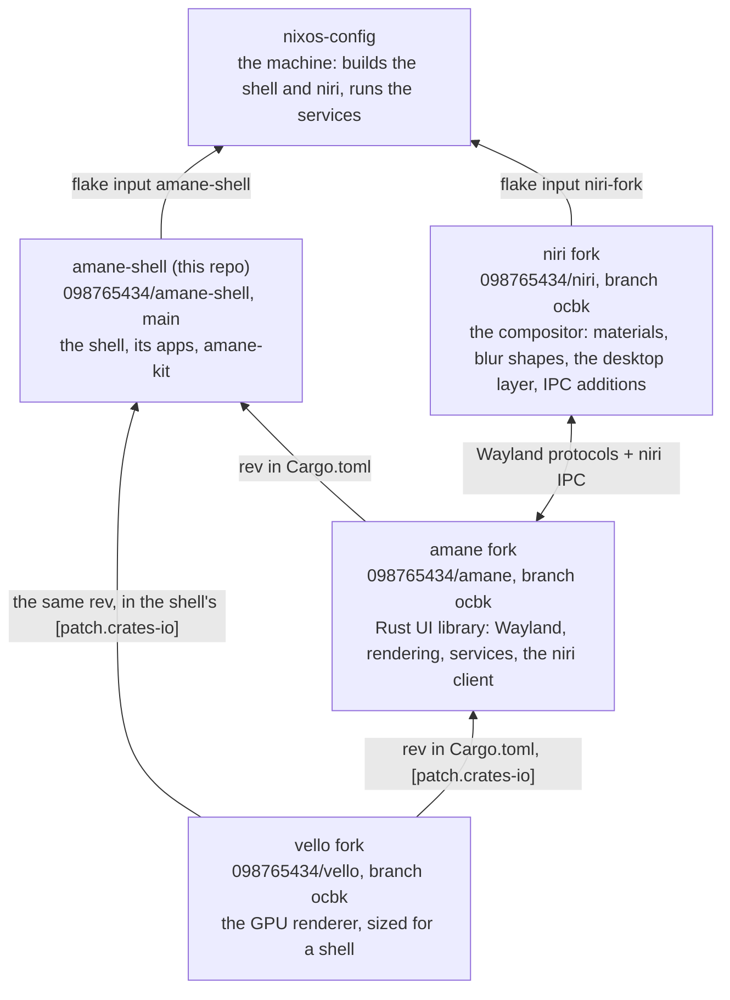

# The stack

**Four repositories make the desktop; each pins the one below it.** The shell pins its library
and the library's renderer; the machine's configuration pins the shell and the compositor.

- **vello fork:** scratch buffers sized for a shell, let go when idle. Upstream is
  [linebender/vello](https://github.com/linebender/vello).
- **amane fork:** the UI library the shell is written in: layer windows, popups, blur regions,
  system services, the niri client. Upstream is amane; what the fork adds is in
  [its docs](https://github.com/098765434/amane/blob/ocbk/docs/fork/README.md).
- **niri fork:** materials and blur shapes, vibrancy, HDR, the workspace mat, the desktop layer,
  gesture IPC. Upstream is now [niri-wm/niri](https://github.com/niri-wm/niri); what the fork
  adds is in [its docs](https://github.com/098765434/niri/blob/ocbk/docs/fork/README.md).
- **nixos-config:** the user's machine, a flake. Not published here; what the shell expects of
  it is in [nixos.md](docs/developer/integration/nixos.md).

## How each piece is pinned

| Piece | Pinned by | Where | Checked by |
|---|---|---|---|
| amane | the shell | `Cargo.toml`, `[workspace.dependencies]` `amane = { git, rev }`; the checkout's hash in `flake.nix` `cargoLock.outputHashes."amane-0.1.2"` | `nix build` (a stale hash fails); `scripts/check-pins` against a local `../amane` |
| vello | the shell, and amane | `Cargo.toml`, `[patch.crates-io]` `vello` and `vello_encoding` at one `rev`, which must be the rev amane's own `Cargo.toml` names (a patch only applies from the root manifest); the hash in `flake.nix` `outputHashes."vello-0.11.0"` | `nix build`; `scripts/check-pins` |
| niri | nixos-config | its `flake.lock`, input `niri-fork`. The shell only records the revision it was tested against, in `contract.toml` | `cargo xtask contract`: amane and niri agree at the pinned revisions ([contract.md](docs/developer/integration/contract.md)) |
| the shell | nixos-config | its `flake.lock`, input `amane-shell` | `nixos-rebuild build` |

## Bumping

The order follows the arrows: **vello → amane → shell → nixos-config**. A change low in the
stack is pushed first, then pinned by the repository above it.

1. **vello** changes are pushed to its `ocbk`, then pinned in amane's `Cargo.toml`.
2. **amane** is pushed, then pinned in the shell: the `rev` in `Cargo.toml`, `cargo update -p
   amane`, the new `outputHashes` entry from a `nix build` that is told the hash is wrong. When
   amane moved its vello too, the shell's `[patch.crates-io]` rev and `vello-0.11.0` hash move
   with it.
3. **The shell** is pushed, then `nix flake update amane-shell` in nixos-config.
4. **niri** is pushed, `nix flake update niri-fork` in nixos-config, and `contract.toml` in the
   shell is set to the same revision. A niri change takes effect at the next login: niri is the
   session.

The commands, the hashes and the switch itself are in [release.md](docs/developer/release.md).
What the shell relies on from each layer, and since which revision, is in
[contract.md](docs/developer/integration/contract.md); the layers and what belongs in each are in
[architecture.md](docs/developer/architecture.md).
