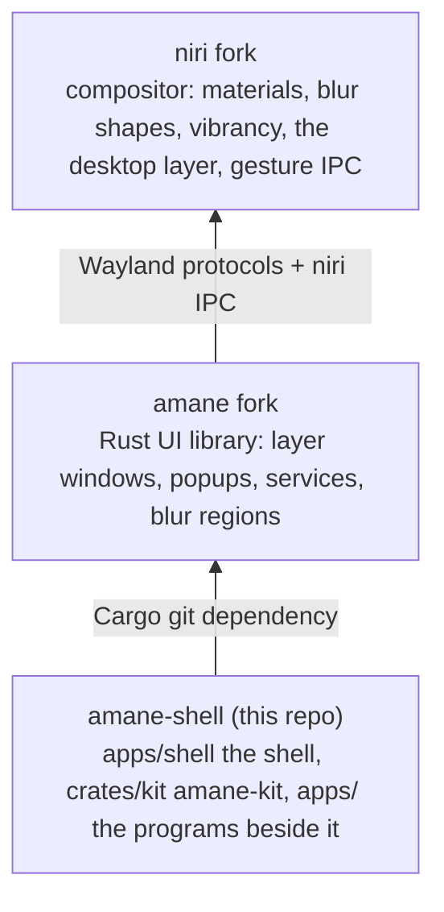

# amane-shell docs

amane-shell is a Wayland desktop shell for niri: a status bar, a dock, the launcher,
notifications, Quick Settings and desktop widgets, plus **amane-kit** (`crates/kit/`), the look as a
library that the shell and its apps (Shell Settings) share. It sits on two forks:

- niri fork: <https://github.com/098765434/niri> (branch `ocbk`); what it adds:
  [docs/fork/README.md](https://github.com/098765434/niri/blob/ocbk/docs/fork/README.md). Not the shell's, but part of the same desktop: the workspace
  mat, a backing niri paints behind the scrolling layout's windows ([layout/workspace-mat.md](https://github.com/098765434/niri/blob/ocbk/docs/fork/layout/workspace-mat.md)).
- amane fork: <https://github.com/098765434/amane> (branch `ocbk`); what it adds:
  [docs/fork/README.md](https://github.com/098765434/amane/blob/ocbk/docs/fork/README.md).

A feature's docs live where its code lives: these docs link to the forks' rather than repeat
them.

Building and running are in the [README](../README.md); contributing in
[CONTRIBUTING.md](../CONTRIBUTING.md).

## Start here

| Doc | What |
|---|---|
| [architecture.md](architecture.md) | the layers, the running shell, how a surface is built, how status apps plug in |
| [integration/contract.md](integration/contract.md) | what the shell relies on from niri, amane and the kit |
| [development/release.md](development/release.md) | bumping the forks, the hashes, nixos-config and the switch |
| [development/testing.md](development/testing.md) | the tests, a second shell beside the live one, measuring |

## Words

The docs use one name for each thing:

- **Shell Settings** is the settings app; its program is `amane-settings`, named once per doc.
- **Quick Settings** is the panel of controls in the bar.
- A **status app** is a program that puts something in the bar; its **status item** is what shows
  there.
- The **notification center** is written in lowercase.
- **color**, in American spelling (the code's `Color` too).
- Features are named for what they are ("the launcher", "glass"), never with another vendor's
  platform terms; `scripts/lint-terms` checks it.

## Source layout

A module's folder says what kind of thing it is. A new one goes where its kind is.

| Folder | What goes there |
|---|---|
| `apps/shell/src/surfaces/` | a surface of its own, a folder each: the status bar, dock, launcher, notifications, Quick Settings, widgets, alert, on-screen display and the password-fill popup (`fill/`), each with its doc in `shell/`; how a surface is laid out is in [shell-structure.md](development/shell-structure.md) |
| `apps/shell/src/chrome/` | what several surfaces share and only the shell has (`panel`, `bar`, `per_output`, `battery`, `workspace_menu`); the rest is the kit's |
| `apps/shell/src/services/` | the shell's services, by domain: `power/`, `network/`, `display/`, `desktop/`, `launcher/`; `vault/` (rbw, for passwords); the assistant's client (`assistant.rs`); the status apps' bus server (`status_apps.rs`); helpers in `process.rs` and `state.rs` |
| `apps/` | the programs beside the shell (`apps/shell`): Shell Settings, Messages, Phone Screen, Shader Lab (with its effects and saved looks), Drop, the assistant's daemon, and `train-watch`, which follows a training run from the status bar |
| `crates/` | what they share: the kit (`crates/kit`, with the design tokens in `design-tokens/`), the status-item client (`status`), the phone (`phone`), the NixOS model (`nixos`), a process runner (`process`), logging (`log`), rbw's pinentry and the assistant's library |
| `apps/shell/tests/fixtures/` | recorded output the shell's parsers are tested on |
| `xtask/` | the workspace's tasks: `cargo xtask layer-rules`, `tokens`, `lint-terms`, `links` |
| `apps/shell/src/tokens/` | what the shell generates from the tokens (niri's layer rules) |
| `crates/kit/src/controls/` | what's pressed, dragged or picked: buttons, slider, dropdown, color picker, tag, control sizes |
| `crates/kit/src/containers/` | what content sits in: card, list, divider, app bar, dialog, tooltip, scroll view, flow, arrangement |
| `crates/kit/src/look/` | the look of glass: materials, the edge shader, glass regions, Shader Lab's looks |
| `crates/kit/src/animation/` | motion, kinetic, pager, edge reveal |
| `crates/kit/src/foundation/` | layout primitives, icons, color arithmetic |
| `crates/kit/src/platform/` | an app's window, app icons, the settings files, markers, secrets |
| `crates/kit/src/tokens/`, `theme.rs` | the design tokens and the theme they resolve with |

The kit's folders don't show in its paths: every module is re-exported at the root, so it's
`amane_kit::card`, not `amane_kit::containers::card`.

## Shell surfaces

| Surface | What it does | Doc |
|---|---|---|
| Status bar | the bar in three sizes: the workspace's shape, status icons, programs' items, Activities, Quick Settings, notifications and the clock | [shell/status-bar.md](shell/status-bar.md) |
| Drop | `amane-drop`, a drop shelf in the bar: a grid of folders, apps and actions, and a Drop Bar | [shell/drop.md](shell/drop.md) |
| Dock | every workspace's windows and pins, rising from the bottom edge and with the overview | [shell/dock.md](shell/dock.md) |
| Launcher | a search pill: search, Applications, Files, Actions, Clipboard | [shell/launcher.md](shell/launcher.md) |
| Passwords | Bitwarden (rbw) fill: a popup by any app's password field, checked by niri; the launcher's Passwords mode | [shell/passwords.md](shell/passwords.md) |
| Assistant | system commands typed or spoken in the launcher, read on this machine by Cactus (Needle 3, Whistle) in the `amane-assistant` daemon | [shell/assistant.md](shell/assistant.md) |
| Notifications | the notification daemon's toasts, the notification center and Do Not Disturb | [shell/notifications.md](shell/notifications.md) |
| Quick Settings | GNOME's quick settings as a grid of glass modules, with Edit Controls | [shell/quick-settings.md](shell/quick-settings.md) |
| Desktop widgets | readings and a clock on the wallpaper, on Quick Settings' grid | [shell/widgets.md](shell/widgets.md) |
| On-screen display | the capsule that shows volume, brightness, the keyboard light, a lock key or a switch as it changes | [shell/osd.md](shell/osd.md) |
| Alert | the shell's alert in the middle of the screen, for questions like "Restart now?" | [shell/quick-settings.md#the-alert](shell/quick-settings.md#the-alert) |
| Shell Settings | the settings app: appearance, the desktop's widgets, the launcher, and the System pages that manage the NixOS configuration | [shell/settings-app.md](shell/settings-app.md) |
| Displays | Shell Settings' page for the screens: what each can do (OLED, HDR, VRR range), resolution, refresh (lower on battery), scale, rotation, arrangement, HDR, a monitor's brightness over DDC/CI, Night Light's schedule | [shell/displays.md](shell/displays.md) |
| Phone | KDE Connect drawn by the shell: Quick Settings' Phone page, the bar's phone battery, Messages (`amane-messages`) for texts and remote input, and the phone's screen, sound, apps and camera through scrcpy (`amane-mirror`) | [shell/phone.md](shell/phone.md) |
| Context menu | nested xdg-popup menus: the dock's, the launcher's, the widgets', Do Not Disturb's and a Bluetooth device's | [shell/context-menu.md](shell/context-menu.md) |

## amane-kit

| Topic | Doc |
|---|---|
| Buttons, switch, checkbox, radio, dropdown, control sizes | [kit/controls.md](kit/controls.md) |
| Card, list, slider, dialog, tag, arrangement, scroll view and the other building blocks; the modules under them | [kit/components.md](kit/components.md) |
| An app's window, text fields and sidebar | [kit/app.md](kit/app.md) |
| The color picker, and hex and HSV helpers | [kit/color-picker.md](kit/color-picker.md) |
| Saved Shader Lab looks, and putting one on a rectangle | [kit/lab.md](kit/lab.md) |
| Springs and fades, keyed list motion, `Kinetic`, `Pager` | [kit/motion.md](kit/motion.md) |

## Design system

| Topic | Doc |
|---|---|
| Design tokens: tiers, naming, Penpot workflow, CI checks | [design-system/tokens.md](design-system/tokens.md) |
| Materials: glass by role, its tints, vibrant labels | [design-system/materials.md](design-system/materials.md) |
| Typography: the type roles, font stacks, text scale | [design-system/typography.md](design-system/typography.md) |
| Tokens still waiting on Penpot | [design-system/penpot-backlog.md](design-system/penpot-backlog.md) |

## Integration

| Topic | Doc | The forks' side |
|---|---|---|
| niri layer rules and surface namespaces, generated from the tokens | [integration/layer-rules.md](integration/layer-rules.md) | niri [materials](https://github.com/098765434/niri/blob/ocbk/docs/fork/effects/materials.md), [desktop layer](https://github.com/098765434/niri/blob/ocbk/docs/fork/layout/desktop-layer.md); amane [blur](https://github.com/098765434/amane/blob/ocbk/docs/fork/graphics/blur.md) |
| Other programs' items in the bar and their Activities, over `org.amane.StatusBar1` | [integration/status-apps.md](integration/status-apps.md) | [amane-status](../crates/status/README.md) |
| Writing a status app: an item, a window under it, drags through it, Activities, running as a service | [integration/writing-a-status-app.md](integration/writing-a-status-app.md) | |
| Every CLI and IPC command, and the socket they go over | [integration/ipc.md](integration/ipc.md) | niri [IPC events](https://github.com/098765434/niri/blob/ocbk/docs/fork/ipc/events.md), [actions](https://github.com/098765434/niri/blob/ocbk/docs/fork/ipc/actions.md) |
| The shell's services and amane's, the settings files and the state files | [integration/services.md](integration/services.md) | amane [compositor services](https://github.com/098765434/amane/blob/ocbk/docs/fork/compositor/services.md), [system services](https://github.com/098765434/amane/blob/ocbk/docs/fork/system/idle.md) (`system/`) |
| The NixOS configuration from Shell Settings: the registry and `managed/settings.json`, the `amaneSettings` output, build → compare → activate through polkit, the commit, "up to date" | [integration/nixos.md](integration/nixos.md) | nixos-config `modules/managed.nix` |
| What the shell relies on from niri, amane and the kit, with the revisions that have it; `cargo xtask contract` | [integration/contract.md](integration/contract.md) | niri [Features](https://github.com/098765434/niri/blob/ocbk/docs/fork/ipc/features.md), [what amane-shell relies on](https://github.com/098765434/niri/blob/ocbk/docs/fork/maintaining.md#what-amane-shell-relies-on) |

## Development

| Topic | Doc |
|---|---|
| Dev shell, checks, the token workflow | [CONTRIBUTING.md](../CONTRIBUTING.md) |
| How `apps/shell/src` is laid out, and the tests that keep it so | [development/shell-structure.md](development/shell-structure.md) |
| Bumping amane, vello and niri, `outputHashes`, nixos-config, the switch | [development/release.md](development/release.md) |
| Fixtures, golden tests, `--ignored` tests, a second shell beside the live one, a fork rebase's checks | [development/testing.md](development/testing.md) |
| What makes a window draw, and the rules that keep an idle desktop still | [development/performance.md](development/performance.md) |
| What the desktop holds in GPU memory, how to measure it, and what has been cut (the vello fork) | [development/memory.md](development/memory.md) |
| Trying shader effects live, and porting Figma shaders | [development/shader-lab.md](development/shader-lab.md) |
| Status apps, Activities and Drop: the pieces across amane, the shell and nixos-config, their threads, testing beside the desktop | [development/status-apps.md](development/status-apps.md) |
| What the shell costs while idle, measured, to compare later work against | [development/idle-baseline.md](development/idle-baseline.md) |
| Features the shell doesn't have yet, by how often they'd be missed | [development/backlog.md](development/backlog.md) |

## Archive

Implemented specs, kept as history and not kept up to date.

| Spec | Superseded by |
|---|---|
| [archive/ROADMAP.md](archive/ROADMAP.md): the 14-phase cleanup of the shell and its forks, finished 2026-11-07 | [architecture.md](architecture.md), [development/release.md](development/release.md), and each fork's `maintaining.md` |
| [archive/spec-design-tokens-v2.md](archive/spec-design-tokens-v2.md): Penpot tokens, the resolver, CI checks | [design-system/tokens.md](design-system/tokens.md) |
| [archive/spec-system-colour-variables.md](archive/spec-system-colour-variables.md): the design kit's labels, fills, materials and control sizes | [design-system/materials.md](design-system/materials.md), [kit/controls.md](kit/controls.md) |
