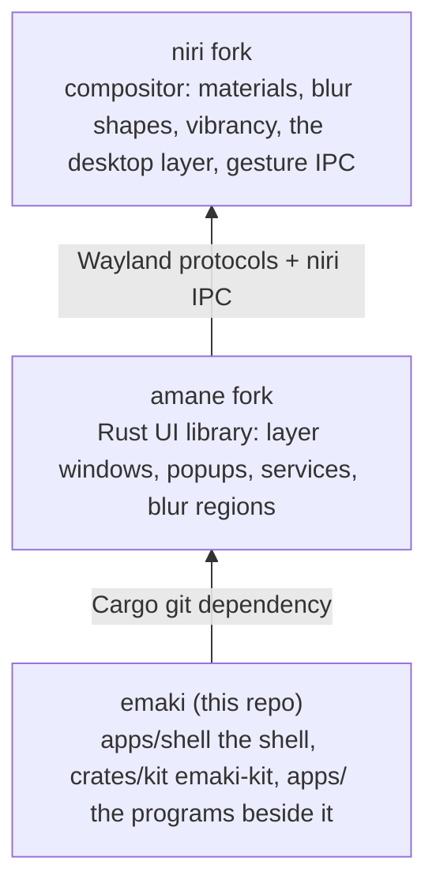

# emaki docs

emaki is a Wayland desktop shell for niri: a status bar, a dock, the launcher,
notifications, Quick Settings and desktop widgets, the apps beside them, and **emaki-kit**
(`crates/kit/`), the look as a library that the shell and its apps share. It sits on two forks:

- niri fork: <https://github.com/098765434/niri> (branch `ocbk`); what it adds:
  [docs/fork/README.md](https://github.com/098765434/niri/blob/ocbk/docs/fork/README.md). Not the shell's, but part of the same desktop: the workspace
  mat, a backing niri paints behind the scrolling layout's windows ([layout/workspace-mat.md](https://github.com/098765434/niri/blob/ocbk/docs/fork/layout/workspace-mat.md)).
- amane fork: <https://github.com/098765434/amane> (branch `ocbk`); what it adds:
  [docs/fork/README.md](https://github.com/098765434/amane/blob/ocbk/docs/fork/README.md).

A feature's docs live where its code lives: these docs link to the forks' rather than repeat
them. How the four repositories pin each other is in [STACK.md](../STACK.md).

The docs are in two halves. `user/` is for someone running the desktop: installing it, setting
it up, and what each surface does. `developer/` is for someone changing it: the architecture,
the kit, the integration points, testing and releasing. The [README](../README.md) is the front
page; contributing is in [CONTRIBUTING.md](../CONTRIBUTING.md).

## Words

The docs use one name for each thing:

- **Emaki Settings** is the settings app; its program is `emaki-settings`, named once per doc.
- **Quick Settings** is the panel of controls in the bar.
- A **status app** is a program that puts something in the bar; its **status item** is what shows
  there.
- The **notification center** is written in lowercase.
- **color**, in American spelling (the code's `Color` too).
- Features are named for what they are ("the launcher", "glass"), never with another vendor's
  platform terms; `scripts/lint-terms` checks it.

## Using emaki

### Setting it up

| Doc | What |
|---|---|
| [user/install.md](user/install.md) | building with the flake, the NixOS service, niri's layer rules, updating |
| [user/configure.md](user/configure.md) | the settings files, theme, density and text size, the environment variables |
| [user/keyboard-and-ipc.md](user/keyboard-and-ipc.md) | the niri keybinds to copy, and the socket in user terms |
| [user/troubleshooting.md](user/troubleshooting.md) | no frost, a missing item, Vulkan, the assistant, the logs |
| [user/screenshots/README.md](user/screenshots/README.md) | the README's pictures, and how to take them |

### Features

| Surface | What it does | Doc |
|---|---|---|
| Status bar | the bar in three sizes: the workspace's shape, status icons, programs' items, Activities, Quick Settings, notifications and the clock | [user/features/status-bar.md](user/features/status-bar.md) |
| Drop | `emaki-drop`, a drop shelf in the bar: a grid of folders, apps and actions, and a Drop Bar | [user/features/drop.md](user/features/drop.md) |
| Dock | every workspace's windows and pins, rising from the bottom edge and with the overview | [user/features/dock.md](user/features/dock.md) |
| Launcher | a search pill: search, Applications, Files, Actions, Clipboard | [user/features/launcher.md](user/features/launcher.md) |
| Passwords | Bitwarden (rbw) fill: a popup by any app's password field, checked by niri; the launcher's Passwords mode | [user/features/passwords.md](user/features/passwords.md) |
| Assistant | system commands typed or spoken in the launcher, read on this machine by Cactus (Needle 3, Whistle) in the `emaki-assistant` daemon | [user/features/assistant.md](user/features/assistant.md) |
| Notifications | the notification daemon's toasts, the notification center and Do Not Disturb | [user/features/notifications.md](user/features/notifications.md) |
| Quick Settings | GNOME's quick settings as a grid of glass modules, with Edit Controls | [user/features/quick-settings.md](user/features/quick-settings.md) |
| Desktop widgets | readings and a clock on the wallpaper, on Quick Settings' grid | [user/features/widgets.md](user/features/widgets.md) |
| On-screen display | the capsule that shows volume, brightness, the keyboard light, a lock key or a switch as it changes | [user/features/osd.md](user/features/osd.md) |
| Alert | the shell's alert in the middle of the screen, for questions like "Restart now?" | [user/features/quick-settings.md#the-alert](user/features/quick-settings.md#the-alert) |
| Emaki Settings | the settings app: appearance, the desktop's widgets, the launcher, and the System pages that manage the NixOS configuration | [user/features/settings-app.md](user/features/settings-app.md) |
| Displays | Emaki Settings' page for the screens: what each can do (OLED, HDR, VRR range), resolution, refresh (lower on battery), scale, rotation, arrangement, HDR, a monitor's brightness over DDC/CI, Night Light's schedule | [user/features/displays.md](user/features/displays.md) |
| Phone | KDE Connect drawn by the shell: Quick Settings' Phone page, the bar's phone battery, Messages (`emaki-messages`) for texts and remote input, and the phone's screen, sound, apps and camera through scrcpy (`emaki-mirror`) | [user/features/phone.md](user/features/phone.md) |
| Context menu | nested xdg-popup menus: the dock's, the launcher's, the widgets', Do Not Disturb's and a Bluetooth device's | [user/features/context-menu.md](user/features/context-menu.md) |

## Developing emaki

### Start here

| Doc | What |
|---|---|
| [developer/architecture.md](developer/architecture.md) | the layers, the running shell, how a surface is built, how status apps plug in |
| [developer/integration/contract.md](developer/integration/contract.md) | what the shell relies on from niri, amane and the kit |
| [developer/release.md](developer/release.md) | bumping the forks, the hashes, nixos-config and the switch |
| [developer/testing.md](developer/testing.md) | the tests, a second shell beside the live one, measuring |

### The code

| Topic | Doc |
|---|---|
| Dev shell, checks, the token workflow | [CONTRIBUTING.md](../CONTRIBUTING.md) |
| The workspace folder by folder, how `apps/shell/src` is laid out, and the tests that keep it so | [developer/shell-structure.md](developer/shell-structure.md) |
| Bumping amane, vello and niri, `outputHashes`, nixos-config, the switch | [developer/release.md](developer/release.md) |
| Fixtures, golden tests, `--ignored` tests, a second shell beside the live one, a fork rebase's checks | [developer/testing.md](developer/testing.md) |
| What makes a window draw, and the rules that keep an idle desktop still | [developer/performance.md](developer/performance.md) |
| What the desktop holds in GPU memory, how to measure it, and what has been cut (the vello fork) | [developer/memory.md](developer/memory.md) |
| Trying shader effects live, and porting Figma shaders | [developer/shader-lab.md](developer/shader-lab.md) |
| What the shell costs while idle, measured, to compare later work against | [developer/idle-baseline.md](developer/idle-baseline.md) |
| Features the shell doesn't have yet, by how often they'd be missed | [developer/backlog.md](developer/backlog.md) |
| The polish plan under way: one copy of each helper, one table per fact | [developer/polish-plan.md](developer/polish-plan.md) |
| Where a rewrite could still make the shell smaller, and where it couldn't | [developer/rewrite-plan.md](developer/rewrite-plan.md) |
| The shell as a framework: extensions in their own processes and repos, a protocol, a Store and a catalogue | [developer/extensions-plan.md](developer/extensions-plan.md) |

### emaki-kit

| Topic | Doc |
|---|---|
| Buttons, switch, checkbox, radio, dropdown, control sizes | [developer/kit/controls.md](developer/kit/controls.md) |
| Card, list, slider, dialog, tag, arrangement, scroll view and the other building blocks; the modules under them | [developer/kit/components.md](developer/kit/components.md) |
| An app's window, text fields and sidebar | [developer/kit/app.md](developer/kit/app.md) |
| The color picker, and hex and HSV helpers | [developer/kit/color-picker.md](developer/kit/color-picker.md) |
| Saved Shader Lab looks, and putting one on a rectangle | [developer/kit/lab.md](developer/kit/lab.md) |
| Springs and fades, keyed list motion, `Kinetic`, `Pager` | [developer/kit/motion.md](developer/kit/motion.md) |

### Design system

| Topic | Doc |
|---|---|
| Design tokens: tiers, naming, Penpot workflow, CI checks | [developer/design-system/tokens.md](developer/design-system/tokens.md) |
| Materials: glass by role, its tints, vibrant labels | [developer/design-system/materials.md](developer/design-system/materials.md) |
| Typography: the type roles, font stacks, text scale | [developer/design-system/typography.md](developer/design-system/typography.md) |
| Tokens still waiting on Penpot | [developer/design-system/penpot-backlog.md](developer/design-system/penpot-backlog.md) |

### Integration

| Topic | Doc | The forks' side |
|---|---|---|
| niri layer rules and surface namespaces, generated from the tokens | [developer/integration/layer-rules.md](developer/integration/layer-rules.md) | niri [materials](https://github.com/098765434/niri/blob/ocbk/docs/fork/effects/materials.md), [desktop layer](https://github.com/098765434/niri/blob/ocbk/docs/fork/layout/desktop-layer.md); amane [blur](https://github.com/098765434/amane/blob/ocbk/docs/fork/graphics/blur.md) |
| Status apps over `org.emaki.StatusBar1`: the protocol, writing one (an item, a window under it, drags through it), Activities, running as a service, and the pieces across amane, the shell and nixos-config with how to test them beside the desktop | [developer/integration/status-apps.md](developer/integration/status-apps.md) | [emaki-status](../crates/status/README.md) |
| Every CLI and IPC command, and the socket they go over | [developer/integration/ipc.md](developer/integration/ipc.md) | niri [IPC events](https://github.com/098765434/niri/blob/ocbk/docs/fork/ipc/events.md), [actions](https://github.com/098765434/niri/blob/ocbk/docs/fork/ipc/actions.md) |
| The shell's services and amane's, the settings files and the state files | [developer/integration/services.md](developer/integration/services.md) | amane [compositor services](https://github.com/098765434/amane/blob/ocbk/docs/fork/compositor/services.md), [system services](https://github.com/098765434/amane/blob/ocbk/docs/fork/system/idle.md) (`system/`) |
| The NixOS configuration from Emaki Settings: the registry and `managed/settings.json`, the `emakiSettings` output, build → compare → activate through polkit, the commit, "up to date" | [developer/integration/nixos.md](developer/integration/nixos.md) | nixos-config `modules/managed.nix` |
| What the shell relies on from niri, amane and the kit, with the revisions that have it; `cargo xtask contract` | [developer/integration/contract.md](developer/integration/contract.md) | niri [Features](https://github.com/098765434/niri/blob/ocbk/docs/fork/ipc/features.md), [what emaki relies on](https://github.com/098765434/niri/blob/ocbk/docs/fork/maintaining.md#what-amane-shell-relies-on) |

## Archive

Implemented specs, kept as history and not kept up to date.

| Spec | Superseded by |
|---|---|
| [developer/archive/ROADMAP.md](developer/archive/ROADMAP.md): the 14-phase cleanup of the shell and its forks, finished 2026-11-07 | [developer/architecture.md](developer/architecture.md), [developer/release.md](developer/release.md), and each fork's `maintaining.md` |
| [developer/archive/spec-design-tokens-v2.md](developer/archive/spec-design-tokens-v2.md): Penpot tokens, the resolver, CI checks | [developer/design-system/tokens.md](developer/design-system/tokens.md) |
| [developer/archive/spec-system-colour-variables.md](developer/archive/spec-system-colour-variables.md): the design kit's labels, fills, materials and control sizes | [developer/design-system/materials.md](developer/design-system/materials.md), [developer/kit/controls.md](developer/kit/controls.md) |
