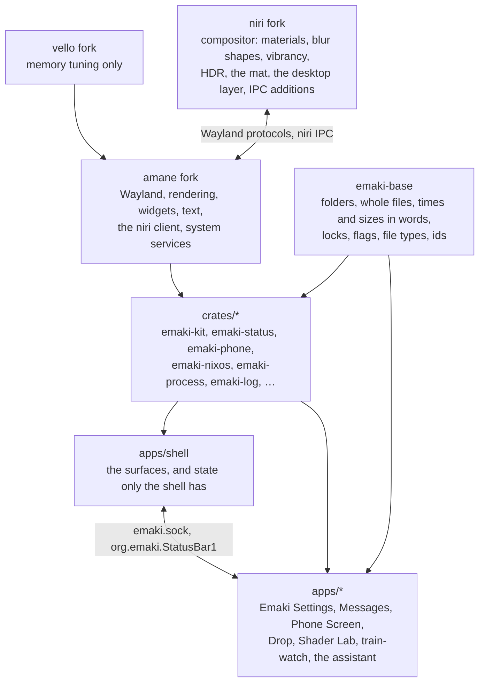
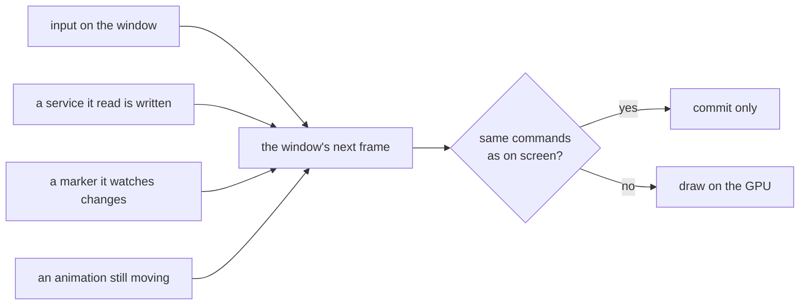
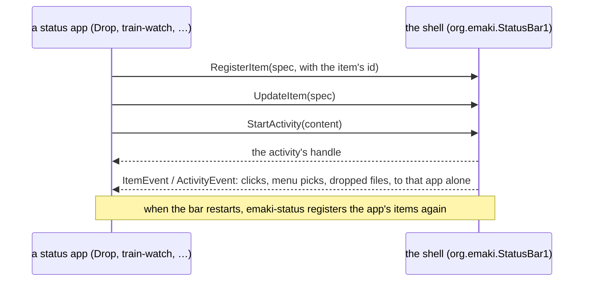

# Architecture

How emaki is put together: the layers and what goes in each, how the running shell works,
how a surface is built, and how other programs plug into the bar. Each section links to the doc
that goes deeper.

## The layers

| Layer | Owns | Never contains |
|---|---|---|
| **niri fork** | compositor rendering and policy: materials, blur shapes, vibrancy, HDR and color management, the mat, the desktop layer, gaps, the IPC additions, and a `Features` request that says which exist | names or behavior specific to emaki |
| **vello fork** | memory tuning only (scratch sizes, releasing idle buffers) | anything else |
| **amane fork** | a generic shell library: Wayland, rendering, widgets, text, the niri client, generic system services, timers, subscriptions, services that stop when unwatched, launching programs in their own systemd scope | UI strings, display timings, `org.emaki.*` interfaces, product features |
| **`crates/*`** | what the shell and its apps share: the kit (the look), the status-item wire types, the phone, the NixOS model, a process runner, logging | surfaces or windows of their own |
| **`crates/base`** | what every program needs below its UI, written once: the XDG folders, writing a file whole, times, lengths and sizes in words, poison-tolerant locks, `--flag` parsing, file types, `%` escapes, interned ids, the programs' ids. std and serde only, so the crates without a window use it; the kit re-exports it | anything that draws or talks to a service |
| **`apps/shell`** | the surfaces and the state only the shell has | generic UI, generic system clients |
| **`apps/*`** | one program each, built on the kit | their own niri, IPC or process clients |

How to decide where new code goes: if a second program could use it and it has no emaki look,
it goes in amane. If it has the look, it goes in the kit. If two of our programs share it but it
isn't UI, it gets a crate, or `emaki-base` when it's a small std-only helper. Otherwise it stays in
the program. `cargo test` holds the line: a hygiene test (`xtask/src/hygiene.rs`) fails on a
helper written again outside its one place.

Code that needs the niri fork asks `amane::niri::features()` at run time, so one build runs on
stock niri too and leaves out what that niri can't do. What the shell relies on from each layer,
and since which revision, is in [contract.md](integration/contract.md).

## The running shell

### One thread draws

amane runs an event loop on the main thread. Wayland events, timers (`amane::Timer`) and wake-ups
from other threads all arrive there, and the windows are drawn there.

amane is immediate-mode: a window's view is rebuilt for each frame, turned into draw commands, and
drawn on the GPU. Quads (rectangles, borders, shadows, glyphs, images, arcs, lines) are cheap;
paths and gradients go through vello. A frame equal to the one on screen isn't drawn again.

A window draws again only when something it showed has changed:

What makes a window draw, what a frame costs and the rules that keep an idle desktop from drawing
at all are in [performance.md](performance.md).

### Services

A service is shared state with a worker behind it, `amane::Service`. Reading one in a view
records that the window depends on it, and a write redraws the windows that read it.

- **Pushed, not polled.** Services follow D-Bus signals, netlink, `/dev/rfkill`, uevents, inotify
  and niri's event stream. Only sysfs that sends no events is polled, and only while watched.
- **Started on demand, stopped when unwatched.** A service starts on its first read, and its worker
  stops when nothing has watched it for a while; the next read starts it again.
- **Following each other.** `Service::subscribe` runs a callback after a write that changed the
  value, on a thread of its own, so one service can follow another without polling and without
  side effects in views.
- **Errors** are a `ServiceError { kind, message, at }`, kept as the last failure. The UI decides
  the words and how long to show it.

The shell's own services, amane's, and the files they keep are in
[services.md](integration/services.md).

### Files

- **Settings** are `~/.config/emaki/*.json`, read through `Config<T>`: watched, so a change
  from Emaki Settings or a text editor shows at once, and written atomically.
- **State** the shell keeps for itself is in `$XDG_STATE_HOME/emaki/`, as JSON with a
  version, written whole. A file in an older format is still read.
- **Logs** go through the `log` crate to stderr, which the journal keeps. `EMAKI_LOG` sets the
  level.

## A surface

A surface is a folder in `apps/shell/src/surfaces/`: the bar, the dock, the launcher,
notifications, Quick Settings, widgets, the password fill, the alert and the OSD.

| File | What |
|---|---|
| `mod.rs` | the surface itself, the functions other surfaces may call, its state |
| `view.rs` | how it draws |
| `input.rs`, `keys.rs` | the pointer and the keyboard |
| `ipc.rs` | its part of the shell's IPC |

A surface's `mod.rs` is its only face to the others; tests fail if one reaches into another's
files. What several surfaces share and only the shell has is in `chrome/` (which panel is open,
where the bar is, per-monitor state). Data two surfaces share is a service. Side effects happen in
services, never in a view. Details in [shell-structure.md](shell-structure.md).

## Talking to the shell

- **The shell's IPC** is `$XDG_RUNTIME_DIR/emaki.sock`, a line protocol that scripts and the apps
  use to open a surface, step the volume, and so on. Apps send the kit's typed `ShellCommand`,
  which writes the same lines. The verbs are in [ipc.md](integration/ipc.md).
- **Status apps** put an item in the bar, and activities beside it, over D-Bus:

The interface is in [status-apps.md](integration/status-apps.md), and how to write one in
[its "Writing a status app" section](integration/status-apps.md#writing-a-status-app). Programs use the `emaki-status`
crate rather than speaking D-Bus themselves.

## Where to read next

- The forks: [amane's docs](https://github.com/098765434/amane/blob/ocbk/docs/fork/README.md) and
  [niri's docs](https://github.com/098765434/niri/blob/ocbk/docs/fork/README.md).
- Making a change reach the desktop: [release.md](release.md).
- Testing it: [testing.md](testing.md).
- Every doc: [docs/README.md](../README.md).
