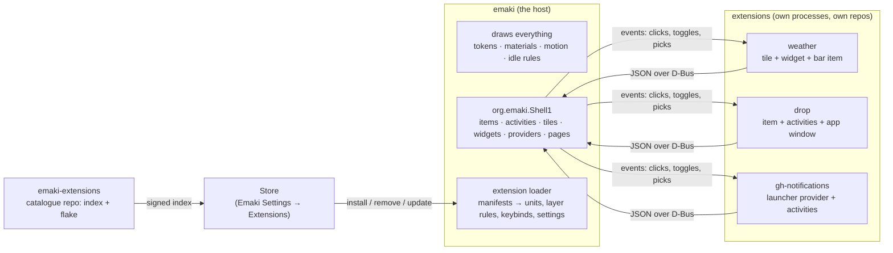

# Extensions plan: the shell as a framework, with a Store

## The question

Rather than rewrite the shell ([rewrite-plan.md](rewrite-plan.md)), could it become a framework:
a core that draws, and features (tiles, widgets, bar items, activities, launcher sources,
Settings pages, whole apps) that live in their own repos, are downloaded from a Store, and can be
written by anyone?

## The answer in short

**Yes, and the shell is already half-way there.** One real extension interface exists today:
`org.emaki.StatusBar1` ([status-apps.md](integration/status-apps.md)). Separate programs put
items in the bar and run Live Activities by sending JSON over D-Bus, the bar draws them in its own
look, and the bar follows them off the bus when they quit. Drop and train-watch are built this way.
Everything else (tiles, widgets, indicators, providers, pages) is a compile-time table inside the
shell.

The plan is to **grow that one interface into the extension protocol**, keep the shell as the only
thing that draws, and ship extensions as ordinary programs in their own systemd units. This is the
shape every stable ecosystem converged on (Android widgets, iOS Live Activities, Zed, COSMIC) and the
shape every fragile one lacks (GNOME, Plasma, Hyprland: code loaded into the shell's process,
breaking on each release). The prior art is in §8.

Three things to be clear about up front:

1. **This doesn't make the codebase smaller.** The shell still has to render every tile, widget and
   row, so the host code stays and grows by about 3–4k lines (the protocol, the loader, the Store).
   What it changes is *what has to live in the shell's repo*: features move out, and new ones never
   come in. The quick wins in the rewrite plan are worth doing regardless.
2. **An extension is a process, not a plugin.** No dynamic libraries, no scripts in the shell's
   process. A crash in an extension is that extension's; a shell release can't break one that speaks
   a protocol version the shell still accepts.
3. **Content and code are labelled apart**, in the manifest, the Store and the catalogue. KDE's
   2024 "theme wiped my home directory" incident was a labelling failure: users thought a theme was
   data. Here a *look* (a saved Shader Lab look, an icon set, a layout) never carries code, and a
   *program* extension always says so.



## 1. What exists, and what each kind needs

The inventory, from the code ([status-apps.md](integration/status-apps.md),
`crates/status/src/protocol.rs`, the surfaces' tables):

| Kind | Today | Declarative already | Needs from the protocol |
|---|---|---|---|
| **Bar item** | `ItemSpec`: icon, title, badge, attention, tooltip, menu, drops | 13 of 14 built-in indicators fit | scroll events (volume); `opens: "quick-settings:power"` to open a shell page |
| **Live Activity** | `ActivityContent`: leading icon, title, subtitle, trailing text/countdown/progress, progress bar, ≤3 buttons, tint, dismiss | 3 of 3 built-ins fit | middle-click; a position that ticks |
| **Quick Settings tile** | `controls.rs` `SPECS`, 22 compile-time | 19 of 22 are a `QuickToggle`: glyph, title, subtitle, checked, alert, sizes | a `TileSpec`, `Toggled(bool)`/`Opened` events, the optimistic `Pending` state shown by the host; a pages vocabulary (switch, list rows, segments, slider, footer link) |
| **Widget** | `WidgetKind` enum, 8; fixed `Settings` struct | 7 of 8 are readings in fixed places: figure, label, caption, glyph, ring, bar, sparkline | typed *pieces* at slots per size; settings as a declared schema + JSON values; the host owns `frozen` and animation |
| **Launcher provider** | `Provider` trait, 10 built in, synchronous | 8 of 10 are `Entry` rows: title, subtitle, icon, badge, action, preview | `Search(query, mode) → entries`, `Activate(key)`; results cached by query, never a bus call per frame |
| **Settings page** | `SIDEBAR` table in Emaki Settings; System pages already render a registry of controls | the System pages | a page = meta + form rows `{id, title, control, path}` over a `Config` file the shell also reads |
| **Notification handler** | none (the phone's "Open on Phone" is hard-coded) | – | a hook: match on app name/hints → extra buttons `(label, argv)` |
| **App** | own binary on `amane::App`, own unit, own layer rule, `StatusItem` | this *is* the working downloadable shape | a manifest, so the loader generates the unit, layer rule, keybind and Settings page instead of hand copies |

What stays custom-drawn, and so stays in the shell: Now Playing, the Display and Sound slider
cards, the stroke clock, the workspace shape, the assistant. That's three tiles, one widget and one
provider. The rest can leave.

**What the bar already hosts stays hosted, and is not the extension protocol.** The tray
(`surfaces/status_bar/tray.rs`) speaks StatusNotifierItem and DBusMenu; Now Playing speaks MPRIS.
Apps already talk those, so the shell keeps serving them, but they are a poor template for
`org.emaki.Shell1`: no size or layout negotiation, icons by name that break under Flatpak, tooltips
limited to five HTML tags, a scroll sign the spec never pinned down, menus in a second (deprecated)
spec, and a pid-based bus name sandboxes refuse. Each of those gaps is a rule in §2.

**Cost of an extension today:** train-watch is 611 lines, about 60 of them protocol; Drop is about
1,840, about 50 of them item and menu wiring. A tile-only extension would be under 100.

## 2. The protocol: `org.emaki.Shell1`

`org.emaki.StatusBar1` is renamed and grown, with the old name kept as an alias for one release.
Every payload stays **one JSON string with a `v`**, as now (`protocol.rs:557`), so a shell script
with `busctl` remains a valid extension.

| Method | Kind | Notes |
|---|---|---|
| `RegisterItem` / `UpdateItem` / `RemoveItem` | bar item | as today, plus `scroll` and `opens` |
| `StartActivity` / `UpdateActivity` / `EndActivity` | activity | as today, plus `middle` and `position` |
| `RegisterTile(spec)` / `UpdateTile` / `RemoveTile` | tile | spec: `id, glyph, title, subtitle, checked, alert, available, sizes, page?` |
| `RegisterWidget(kind)` / `UpdateWidget(id, face)` | widget | `kind`: name, title, blurb, glyph, category, sizes, settings schema; `face`: pieces per size |
| `RegisterProvider(spec)` | launcher | the shell calls back `Search` on the owner's object; `Activate(key)` |
| `RegisterPage(spec)` | Settings | rows over a named `Config` file; Emaki Settings draws it. Controls are a closed set (Raycast's): `text`, `password`, `switch`, `dropdown`, `file`, `directory`, each with `required` and `default`. A `password` lives in the secret service, written by the host; an extension never touches the keychain |
| `RegisterHandler(match)` | notifications | extra buttons for notifications matching `match` |
| `Hello(manifest_id, level, locale?) → s` | – | the first call: the shell answers with the kinds it serves, its protocol level, the user's locale and the theme's density and orientation; a level above the shell's gets `Error.Level` with the shell's level in it, so the extension can say "needs shell N" instead of failing somewhere later (Plasma 6's `X-Plasma-API-Minimum-Version` lesson) |

Signals, unicast to the owner as now: `ItemEvent`, `ActivityEvent`, `TileEvent(id, Toggled|Opened|
PageAction)`, `WidgetEvent(id, Pressed|SettingsChanged)`, `ProviderEvent(Activated(key))`.

**Rules, inherited from the bar and from the precedents in §8:**

- **The host renders.** No colours, fonts, sizes or motion cross the bus; a spec names a glyph,
  a tint role (`accent`, `critical`), a size class. The look is always the shell's, so an extension
  can't be off-brand and a token change restyles every extension at once.
- **Versioned and closed.** The protocol has one integer **level** (today's `v`), declared in the
  manifest and in `Hello`. A payload above the shell's level is refused with `Error.Level`. The
  rules for what the shell does with a payload are Adaptive Cards' rules, verbatim: an unknown
  *element* (a piece, a control, a row kind) is dropped and logged as a warning, an unknown
  *property* is kept and ignored, an element may carry a `fallback` element or `"drop"`, and a
  payload may say what it `requires` so the host can choose the fallback up front.
- **A level lives for two shell minor releases after the next level ships**, then is refused. Zed
  never wrote this rule down and now carries ten WIT snapshots forever; KDE and GNOME tied
  extensions to the host's release instead and break them every release. Every level that ever
  shipped gets a binding; a number is never skipped (Zed's 0.7.0 gap made every extension on it
  uninstallable for a release).
- **Budgeted, in numbers.** Each is a constant in `emaki-extension` and a line in the Store's page
  for the extension. The reference points are the platforms that have run host-rendered content for
  a decade: Android widgets refresh at most every 30 minutes, WidgetKit allows 40–70 refreshes a
  day, a Live Activity carries 4 KB and lives 8 hours plus 4 on the lock screen, GNOME Shell keeps
  10 notifications per source, Adaptive Cards allow 5 actions.

  | Budget | Rule | Enforced where |
  |---|---|---|
  | Payload | 64 KB of JSON per call; images never inline (below) | decode, `Error.TooLarge` |
  | Update rate | 1 update per 100 ms per object, 20 per second per owner; extra updates coalesce into the latest | host queue per owner |
  | Queue depth | 10 pending calls per owner; the 11th gets `Error.Busy` | host queue per owner |
  | Activities | 8 hours, then ended; 3 buttons; as today | host timer |
  | Actions | 5 buttons or menu items per tile page, per widget | decode, clamped |
  | Ticking | the host, not the owner, ticks countdowns, progress, sparklines and relative times | host |
  | Wakeups | an idle extension sends nothing; the idle baseline ([idle-baseline.md](idle-baseline.md)) with every bundled extension running is the acceptance test | idle report |

  D-Bus does not do this for us: the spec allows 128 MiB per message, the session bus raises every
  limit to "essentially infinite", and dbus-broker's quotas are per user, so one noisy extension
  starves the user's other clients but never gets throttled on the shell's behalf.
- **Icons by name, pixels by file.** An icon is a glyph name or a themed icon name, and may carry a
  fallback: a PNG or SVG passed as a file descriptor or a path under the extension's own data
  directory. The name wins when the theme has it. Never ARGB arrays in JSON (StatusNotifierItem's
  mistake, and why Flatpak tray icons break). Widget `image` pieces work the same way.
- **Pieces, not drawing.** A widget face is a list of typed pieces (`figure`, `label`, `caption`,
  `glyph`, `ring`, `bar`, `sparkline`, `image`) at the slots a size offers. That covers 7 of 8
  built-in widgets. Custom drawing is not offered; a feature that needs it is a shell feature.
- **Words in the user's language.** `Hello` tells the extension the locale; the extension sends
  translated strings. The host never sees msgids. Strings have length clamps per slot, as the
  bar's `ItemSpec` has today.
- **Scroll has a sign.** `scroll` events carry a signed step count, positive is up or right, and
  the host says in the spec which axis a slot supports.
- **No embedding.** An extension that needs a surface of its own (Drop, the assistant's window)
  opens one on `amane::App` with the layer rule the loader generates, as apps do today; this works
  because programs on the host are trusted by niri. There is no Wayland protocol for a shell to
  embed another process's surface and niri has no `xdg-toplevel-tag`, so the shell does not offer
  it; COSMIC gets it only by making its panel a nested compositor.

One **Rust crate, `emaki-extension`** (today's `emaki-status`, grown), holds the types and the
client: `Tile::register`, `Widget::register`, `Provider::serve`. It re-registers everything when
the shell restarts, as the status client does now. It depends on nothing of amane's rendering, so
an extension binary is small and builds fast. Other languages use D-Bus directly.

## 3. The manifest

Each extension ships an `extension.toml`. The loader reads it; nothing else is hand-wired.

```toml
[extension]
id = "org.emaki.weather"          # reverse-DNS; never changes (layouts, order and hiding key on it)
name = "Weather"
version = "1.2.0"
kind = "program"                  # or "look", "icons", "layout": content with no code
level = 1                         # the org.emaki.Shell1 level it speaks (an integer, see §2)
license = "MIT"
summary = "Conditions and a forecast from Open-Meteo"
homepage = "https://github.com/…/emaki-weather"

[program]
exec = "emaki-weather"            # started as its own user unit, D-Bus activated (see §4)
bus_name = "org.emaki.weather"    # the name it claims; the loader writes the .service file for it
capabilities = ["network"]        # the closed list below; each one is a unit directive, and the
                                  # Store shows exactly this list above Install

[provides]
tiles = ["weather"]
widgets = ["weather.now", "weather.week"]
items = ["weather"]
providers = []
pages = ["weather"]               # drawn by Emaki Settings from the spec the program registers

[[keybinds]]                      # offered, not imposed: the user accepts them in the Store
action = "open-forecast"
default = "Mod+Shift+W"

[window]                          # only for an extension with a surface of its own
namespace = "emaki-weather"       # the loader generates the niri layer rule
material = "panel"
```

From the manifest the loader generates what today is copied by hand: the systemd user unit, the
niri layer rule (`tokens/layer_rules.rs` becomes the one writer for extensions too), the keybind
proposal, the Settings sidebar entry, and the "seen" lists Emaki Settings keeps.

**Capabilities are only shown if they are enforced.** Dux Shell's plugins declare `network` and
`process` permissions but the shell enforces one of them; Noctalia refuses a permission model
outright and says so. A label the host can't back is worse than none. So the list is closed, and
each entry is the unit directive that denies it when absent:

| Capability | Absent means | Directive |
|---|---|---|
| `network` | no sockets but Unix | `RestrictAddressFamilies=AF_UNIX` |
| `home` | reads and writes only its own `$XDG_*` dirs | `ProtectHome=tmpfs` + `BindPaths=` (needs user namespaces; see §4) |
| `spawn` | no child processes | `SystemCallFilter=~@process` minus `execve`; checked by review |
| `secrets` | no Secret Service | the host's D-Bus policy refuses `org.freedesktop.secrets` from the unit |
| `shell:<kind>` | may only register the kinds in `[provides]` | the host checks `provides` on every `Register*` |

A baseline applies to every program whether or not it declares anything, because these work in a
user unit without namespaces: `NoNewPrivileges`, `SystemCallFilter=@system-service`,
`MemoryDenyWriteExecute`, `LockPersonality`, `RestrictRealtime`, `LimitCORE=0`. This is the
assistant's unit today; Drop's and train-watch's have none of it.

## 4. The loader (in the shell)

A new service, `services/extensions/`, which names no surface (the boundary test holds):

1. **Discover.** Manifests in `$XDG_DATA_DIRS/emaki/extensions/*/extension.toml` (system and
   Nix profile), then `$XDG_DATA_HOME/emaki/extensions/` (user-installed), later wins.
2. **Check.** Level ≤ host's; id unique and not installed from both the profile and the system
   (§5); `kind = "program"` has an `exec` on `PATH` or beside the manifest.
3. **Enable.** Write `extensions.json` (`Config`, so Settings and the shell both follow it): which
   are enabled, which keybinds accepted. An enabled program gets two generated files: a D-Bus
   service file for its `bus_name` with `SystemdService=emaki-ext-<id>.service`, and that unit:
   `Type=dbus`, `BusName=`, `Slice=app.slice`, `PartOf=graphical-session.target`, the baseline
   directives and the ones its capabilities leave out (§3). It is **never** a child of the shell:
   systemd kills by cgroup, so anything the shell forks dies with it (the reason a switch that
   restarts the shell kills the apps it launched today). D-Bus activation also means a restarted
   shell finds the extensions still running and re-attaches, rather than respawning them.
4. **Serve.** The program comes up, says `Hello`, registers over `org.emaki.Shell1`, and its
   tiles, widgets and items appear where the user had them (layouts already key on the name
   string, so an extension that was missing at boot takes its place back on arrival).
5. **Crash.** `Restart=on-failure` with `RestartSteps=5`, `RestartMaxDelaySec=30` and
   `StartLimitBurst=5` in `StartLimitIntervalSec=2min`. When the unit hits the start limit the
   loader marks the extension *Disabled after repeated crashes* in `extensions.json`, Settings
   shows that with the last twenty lines of its journal, and a successful `Hello` resets the
   count. A clean exit (Drop's "Quit") is not a crash and is not restarted, as cosmic-panel does.
6. **Disable / remove.** Stop the unit; the bus does the rest. Removing a look or icon set is a
   file delete; nothing to stop.

**What hardening a user unit can do.** Seccomp-class directives always work. Mount-based ones
(`ProtectHome`, `PrivateTmp`, `ReadOnlyPaths`, `BindPaths`) work only through the implicit
`PrivateUsers=` of user services, which needs unprivileged user namespaces; `User=`,
`ProtectProc=` and `ProtectControlGroups=` never work in `--user`. The loader probes once at start
and the Store shows `home` as "not enforceable on this machine" when it isn't. And, as niri's
security model notes, a filtered Wayland socket means little while the session bus is open: the
host's own `provides` check and D-Bus policy are the part of the sandbox that is ours to write.

**Content extensions** (`kind = "look" | "icons" | "layout"`) are files only: a saved Shader Lab look
(`kit::lab::look` already loads these), a glyph set, a Quick Settings or widget layout. The loader
makes them selectable in Emaki Settings. They are the safe half of the catalogue and the Store
says so.

## 5. The Store

A **Store** section in Emaki Settings (not a new binary: one more sidebar group, built from the
same `SIDEBAR` table), with four pages:

- **Browse.** The catalogue index: name, summary, kind badge (*Look* / *Program*), what it provides
  (tile, widget, item…), declared capabilities (network, files, secrets), protocol compatibility
  with this shell, author, licence, last update. Search over words, as the Apps page does.
- **Installed.** Enabled/disabled, version, "update available", the keybinds it offered, its
  Settings page link, Remove.
- **Updates.** From the scheduled check that exists for NixOS (`emaki-update-check`), extended to
  the catalogue index.
- **An extension's page.** Screenshots from the catalogue, the full manifest, the repo link,
  *Install* / *Remove* / *Enable*.

The Store's own page for a `program` extension says plainly, above *Install*: "This is a program.
It runs as you and can do what you can." (David Edmundson's lesson, see §8.)

### Installing, on NixOS

Two paths, and the user picks one per machine in the Store's settings; never both for one
extension (the Home Manager experience says the middle is fragile):

| Path | How | For whom |
|---|---|---|
| **Imperative (default).** | `nix profile add --profile $XDG_STATE_HOME/emaki/extensions/profile github:…/emaki-extensions#<id>` (`add` since Nix 2.30; `install` stays an alias). The loader reads that profile's `share/emaki/extensions/`. No root, no rebuild, seconds. Updates are `nix profile upgrade` on that profile. | most users; what "a Store" means |
| **Declarative.** | The Store writes `extensions: ["weather", …]` into `managed/settings.json`; `modules/managed.nix` maps it to `emaki.extensions`, which installs the catalogue flake's packages system-wide. Apply builds and activates as today ([nixos.md](integration/nixos.md)). | users who want the machine reproducible from the repo |

Both read the same catalogue flake, so an extension is one derivation either way, and the Store's
index entry carries the flake output name.

Four rules from how `nix profile` actually behaves:

- **Install by flake reference, never by store path.** A store-path install records no source, so
  `nix profile upgrade` skips it forever. The flake reference is unlocked (`github:…#id`), and each
  upgrade pays a cold evaluation because the eval cache is keyed on the catalogue's lock.
- **The profile is never on `PATH`.** The loader finds it by path. `~/.nix-profile` already shadows
  `/etc/profiles/per-user`, and a second profile on `PATH` would make "which weather am I running"
  a question. The loader refuses the same id from both the profile and the system (§4 step 2).
- **The profile path is permanent.** Every generation is an indirect GC root under
  `/nix/var/nix/gcroots/auto`, which cannot be moved or renamed. The Store runs
  `nix profile wipe-history --older-than 30d` on that profile with the update check, or old builds
  of every extension accumulate.
- **The manifest is opaque.** Its format changed in Nix 2.20 (v3, keyed on names), older Nix can't
  read an upgraded profile, and the manual's page for it is stale. The Store reads
  `nix profile list --json` and nothing else.

No shipped NixOS GUI installs into a profile today (nix-software-center is dormant, the PackageKit
backend is disabled in nixpkgs), so this path is new ground and gets its own tests.

**Other distros** come later: the catalogue's CI publishes static binaries per release, signed with
minisign; the loader's user directory accepts them. The protocol and manifest don't change.

## 6. The catalogue: `emaki-extensions`

A separate repo, modelled on Zed's and Flathub's indexes:

```
emaki-extensions/
  flake.nix            # packages.<system>.<id> for every extension, built from pinned sources
  index.json           # what the Store shows: generated by CI, signed with minisign
  extensions/<id>.toml # one entry per extension: repo, rev, sha256, manifest excerpt, screenshots
  REVIEW.md            # the rules
  .github/workflows/   # build every entry against the current SDK; refuse an index that doesn't build
```

**Submitting** is a pull request adding `extensions/<id>.toml`. CI builds it, runs the manifest
checks, and renders its tiles and widgets in the kit's example harness for a screenshot the
reviewer looks at. Updating is a PR bumping `rev` and `sha256`; it is reviewed like a submission,
and CI runs on every version, not only the first (Obsidian re-scans every release; Stream Deck
reviews every version; the 2024 KDE theme was a version nobody looked at).

**Process rules**, the ones every catalogue that lacked them grew a FAQ apologising for:

- one extension per PR, three open PRs per author (Zed);
- the PR template is filled in full or the PR is closed (HACS);
- `version` in the entry must equal `version` in the pinned manifest, and the pinned `rev` must be
  on a branch, both checked by CI (Zed's Danger only checks the file was touched);
- the author attests to a manual test at the pinned commit against the shell version named;
- a validation action authors run in their own repo before submitting (HACS Action);
- stale after 14 days without an answer, closed after 21, reopenable (Raycast);
- the expected turnaround is written in the README and kept honest;
- an abandoned extension (broken, three contacts unanswered over six weeks) may be forked into the
  catalogue's own org (Zed's rule), and transfer, deprecation and removal each have a documented
  path and a workflow.

**Review rules** (EGO's list is a good template; short, written down):

- the id is reverse-DNS under a domain or GitHub name the author controls, and ownership is
  proven as Flathub does: `io.github.<user>.*` by signing in with that account, a domain by a
  token at `/.well-known/org.emaki.Extensions.txt` or a `_emaki` TXT record. Entries that pass are
  `verified` in the index and get a mark in Browse; GNOME Software labels anything else
  "Provided by a third party";
- a `program` declares every capability it uses, from the closed list in §3, and the Store shows
  them;
- no obfuscated or minified sources; the build is from source in CI;
- no self-updating and no code fetched at run time (every browser store's first rule);
- no telemetry without a switch that defaults off;
- no duplicating a built-in without doing something it doesn't (Raycast, Zed);
- it must stop cleanly: leaving the bus leaves nothing behind (the host enforces this anyway);
- an OSI licence that GitHub can detect (HACS fails `NOASSERTION`);
- a `look` or `icons` entry contains no executable files, checked by CI.

**Trust.** The index is signed with one minisign key whose public half ships in the shell;
verification is offline, with the zero-dependency `minisign-verify` crate. Each entry pins a `rev`
and `sha256`, so the flake is reproducible and the Store never fetches a moving branch. One key is
enough against tampering but not against the two attacks TUF adds, so the index carries, inside
the signed bytes:

- `expires`: a date about two weeks out, refreshed by CI; the Store treats an expired index as
  "can't check for updates", not as current (apt's `Valid-Until`; defeats a frozen mirror);
- `serial`: a number the Store persists and refuses to go below (TUF's timestamp rule; defeats
  rollback to an index that still lists a withdrawn entry);
- `next_key`: the public key that will sign after this one, so rotation is implicit (OpenBSD
  signify ships release N+1's key inside release N; minisign has no rotation of its own);
- `sha256` for every artifact, so the static-binary path in §7 verifies downloads without a new
  design (Zed's client checks nothing but `Content-Length`; crates.io's RFC 3724 signs the index
  and hashes the artifacts, the same shape);
- `withdrawn`: ids and versions pulled for cause. The loader disables an installed match and
  Settings says why; a delisted extension never silently stays (Obsidian users have asked for this
  since 2022).

Full TUF roles and Sigstore keyless are both more than one maintainer can run (Sigstore's own
founder says so of TUF timestamps on a cron job), and `rust-tuf` is still beta. If the catalogue
ever has several signers, `tuf-on-ci` is the step up.

**Format.** `extensions/<id>.toml` is the source of truth, and CI generates two things from it and
the manifest: `index.json` for the Store, and an AppStream `addon` component per extension
(`<extends>org.emaki.Shell</extends>`, screenshots, `<releases>` with `<artifact>` checksums,
`<content_rating>`, `<custom>` keys for level and capabilities). AppStream already has a validator
and is what Discover and GNOME Software read; emitting it costs a template and keeps that door
open.

**Compatibility.** Each entry names the protocol level it speaks and the shell version it was
tested against. The Store hides entries this shell can't serve, and the loader refuses them, so a
shell upgrade degrades an old extension to "needs an update" rather than to a crash or a blank
tile.

## 7. Phases

| Phase | What | Size |
|---|---|---|
| **0. Pin the protocol** | `Hello`, the level and its lifetime, the budget table and the Adaptive Cards drop/keep/fallback rules as code in `emaki-extension` (today's `emaki-status`, with the old name re-exported), icons by name with a file fallback. | S |
| **1. Tiles and bar items** | `RegisterTile` and the toggle vocabulary, `scroll` and `opens` on items. Move **Software Update** and **Weather** out as the first extensions in this repo's `extensions/` folder (still built by this flake), to prove the path with features that exist. | M |
| **2. Manifest and loader** | `extension.toml`, `services/extensions/`, generated D-Bus service files and units with the baseline hardening and capability directives, crash quarantine, layer rules, `extensions.json`, the Store's *Installed* page. Drop and train-watch gain manifests and lose their hand-written units in home.nix. | M |
| **3. Widgets and pages** | widget kinds and faces as pieces; the settings schema; `RegisterPage` drawn by Emaki Settings' existing registry renderer (`system/controls.rs`). Move the six readings widgets out. | L |
| **4. Providers and handlers** | `RegisterProvider` with cached async results; the notification handler hook; the phone's "Open on Phone" becomes the phone extension's. | M |
| **5. The catalogue and Store** | the `emaki-extensions` repo, CI, the signed index with `expires`/`serial`/`next_key`/`withdrawn`, id verification, the Browse/Updates pages, `nix profile` install into the off-`PATH` profile, the declarative `emaki.extensions` option. | L |
| **6. Contributors** | a `cargo generate` template (`emaki-extension-template`: tile + widget + item in 80 lines), `docs/integration/writing-an-extension.md` replacing the status-app guide, the review and process rules, the validation action, a *Submit* link in the Store. | S |
| **7. Later** | static binaries for other distros, verified by the index's hashes; AppStream output consumed by Discover or GNOME Software; `security-context-v1` sockets for extensions installed as Flatpaks. | – |

**Not planned: a WASM host.** Zed chose WASM so an extension could not crash the editor; a process
gives us that already. A WASM host would add a dependency with a major release every month, a
second contract to version (Zed's WIT has ten compatibility rows after two years) and a second
distribution format, for the sake of a unit converter that a 2 MB process serves fine.

Phases 1–4 each move a built-in out *and* keep it working, so the look stays checkable against the
Phase 0 screenshots of the polish plan at every step, and the idle report shows what a process per
extension costs. If that cost shows, one process may serve several extensions (one manifest, many
`provides`), which the protocol allows from the start.

## 8. What others did, and what to take from it

| System | Mechanism | Isolation | Breaks | Store |
|---|---|---|---|---|
| GNOME Shell | JS patched into the process; the maintainers say no stable API is possible while extensions patch the GUI | none | every release (one zip can't span 44 and 45; 48 and 49 each removed APIs) | human review, written rules, `shell-version` lists; `gnome-extensions upload` for CI since 49 |
| Plasma | QML packages in-process; `X-Plasma-API-Minimum-Version` since 6 so an old widget gets a specific error | none | major releases, private imports | unmoderated store; 2024 incident → `ContentWarning=Static\|Executable` in knsrc and a louder dialog; the 2025 sprint still lists no pre-upload review and no minimum version as open |
| COSMIC | separate processes; the panel is a nested compositor, so applets own real surfaces and popups; found by `.desktop` keys | process; `security-context-v1` socket for applets that ask for the host display | low | applets as Flatpaks in COSMIC Store; restart on non-zero exit with exponential backoff |
| Waybar custom | a script printing JSON | process | none | none |
| Dux Shell (ex-DMS), Noctalia | QML or Luau in the shell's process; `plugin.json` / `plugin.toml` with an integer API level, declared permissions (one enforced) | none | API level | Git registries (400 and 340 entries), PR + CI validation, `/broken` `/deprecated` flags after merge |
| Hyprland | C++ `.so` per commit hash; an opt-in permission system since 0.48 | none | every commit, dependency ABI drift | `hyprpm` builds from source |
| Zed | WASM + versioned WIT; the host renders, the extension never draws; every snapshot since 0.0.1 still loads | memory sandbox; panics contained only since late 2025 | low | Git index with submodules, one extension per PR, three open per author, three-week stale close; no hash or signature on downloads |
| Raycast | React elements the host renders (List, Grid, Detail, Form, MenuBarExtra); typed `preferences` in the manifest | one Node process per extension, no policy sandbox | low; deprecated aliases kept | monorepo PR, first contact in a week, keychain access refused, opaque binaries refused |
| Android widgets, iOS Live Activities, WidgetKit | declarative snapshot the system renders; budgets (30 min, 4 KB, 8 h + 4 h, 40–70 refreshes a day) | process | low | platform store |
| Adaptive Cards | JSON with required `version`, `fallback`, `requires`; unknown elements dropped with a warning, unknown properties kept | – | low | – |
| Flathub | AppStream metainfo, id ownership proven by domain or forge login, permissions shown as "Potentially Unsafe" | Flatpak | – | PR review, verified badge, GPG-signed OSTree summary |

What this plan takes:

- **From COSMIC:** processes, not plugins; discovery by manifest; one unit per extension; restart
  on failure with backoff, never on a clean exit.
- **From Android/iOS/Adaptive Cards:** the host renders a closed, versioned vocabulary with
  budgets in numbers; drop unknown elements, keep unknown properties, offer `fallback`.
- **From Zed:** a Git index with PR review and process rules; the extension never draws. And the
  two things not to copy: no written lifetime for a contract snapshot, no integrity check on
  downloads.
- **From Raycast:** the typed preferences vocabulary, and the host owning passwords.
- **From GNOME:** the review rules, and the lesson that "any API, in-process" means every release
  breaks everyone.
- **From KDE and Plasma 6:** label content and code apart, in the manifest and on the install
  button; an integer minimum level so an old extension gets a specific error.
- **From Dux Shell and Noctalia:** a registry is a manifest plus CI; a permission you don't
  enforce is one you don't show.
- **From Flathub:** prove who owns an id; show capabilities before Install; AppStream for the
  catalogue.
- **From apt, signify and TUF:** a signed index expires, has a serial, carries its next key and
  hashes its artifacts.
- **From Nix:** one derivation per extension in a catalogue flake; imperative installs by flake
  reference into an off-`PATH` profile the loader reads, declarative ones through
  `managed/settings.json`; never both.

## 9. Risks

| Risk | Answer |
|---|---|
| A process per extension raises idle wakeups and RAM | the protocol lets one process serve many extensions; the host ticks countdowns and sparklines itself; updates are rate-limited; the idle report gates each phase |
| The vocabulary is never enough | it covers 19/22 tiles, 7/8 widgets, 13/14 items, 8/10 providers today; what it doesn't cover stays a shell feature, as on every platform with widgets |
| Protocol churn strands extensions | one integer level, declared in the manifest and in `Hello`, with a written lifetime (two shell minors after the next level); every level gets a binding; the Store hides what this shell can't serve |
| A malicious or careless program | it runs as the user, like any program the user installs, and the Store says so; declared capabilities enforced by the unit, source builds in CI, review of every version, a signed index with a withdrawn list the loader acts on |
| A declared capability the machine can't enforce | the loader probes user namespaces once; the Store shows `home` as "not enforceable here" rather than pretending |
| A frozen or rolled-back index | `expires` and `serial` inside the signed bytes; an expired index means "can't check", not "all current" |
| An extension crash-loops and wakes the shell | systemd's start limit, then quarantine in `extensions.json` with the journal tail in Settings |
| Settings pages drawn from a spec look different from hand-built ones | the System pages are already drawn from a registry with the same rows; a spec page uses the same renderer |
| The catalogue becomes a second job | PR-based, CI-built, small rules, stale timers, a validation action authors run first; a maintainer approves, CI does the rest |

## 10. Where to read next

- The interface as it is: [status-apps.md](integration/status-apps.md),
  [its "Writing a status app" section](integration/status-apps.md#writing-a-status-app).
- The NixOS machinery the Store reuses: [nixos.md](integration/nixos.md).
- The idle rules every extension must respect: [performance.md](performance.md),
  [idle-baseline.md](idle-baseline.md).
- The rewrite that this plan replaces, and the quick wins worth doing anyway:
  [rewrite-plan.md](rewrite-plan.md).

## 11. Sources for §2, §4, §6 and §8

- Zed: [WIT snapshots](https://github.com/zed-industries/zed/tree/main/crates/extension_api/wit),
  [host dispatch by version](https://github.com/zed-industries/zed/blob/main/crates/extension_host/src/wasm_host/wit.rs),
  [publishing guide](https://zed.dev/docs/extensions/publishing/publishing-guide),
  [prerequisites](https://zed.dev/docs/extensions/publishing/prerequisites).
- COSMIC: [panel applet launch, security context, restart](https://github.com/pop-os/cosmic-panel/blob/master/cosmic-panel-bin/src/space/wrapper_space.rs),
  [libcosmic applet book](https://pop-os.github.io/libcosmic-book/panel-applets.html).
- GNOME: [review guidelines](https://gjs.guide/extensions/review-guidelines/review-guidelines.html),
  [updates and breakage](https://gjs.guide/extensions/overview/updates-and-breakage.html),
  [architecture thread, 2025](https://discourse.gnome.org/t/gnome-shell-architecture-feels-fundamentally-flawed-panel-extensions/28106).
- KDE: [knewstuff `ContentWarning`](https://github.com/KDE/knewstuff/blob/master/README.md),
  [Plasma 2025 sprint on KNewStuff](https://community.kde.org/Sprints/Plasma/2025/Topics/KNewStuff),
  [`X-Plasma-API-Minimum-Version`](https://develop.kde.org/docs/plasma/widget/porting_kf6/).
- Registries: [Dux Shell plugin registry](https://github.com/AvengeMedia/dms-plugin-registry/blob/main/CONTRIBUTING.md),
  [Noctalia plugins](https://noctalia.dev/plugins), [Raycast manifest](https://developers.raycast.com/information/manifest),
  [Raycast store checklist](https://developers.raycast.com/basics/prepare-an-extension-for-store),
  [Obsidian developer policies](https://docs.obsidian.md/Community+directory/Developer+policies),
  [HACS inclusion](https://hacs.xyz/docs/publish/include).
- Budgets: [Android `updatePeriodMillis`](https://developer.android.com/reference/android/appwidget/AppWidgetProviderInfo#updatePeriodMillis),
  [WidgetKit refresh budget](https://developer.apple.com/documentation/widgetkit/keeping-a-widget-up-to-date),
  [Live Activities limits](https://developer.apple.com/documentation/activitykit/displaying-live-data-with-live-activities),
  [Adaptive Cards renderer rules](https://learn.microsoft.com/en-us/adaptive-cards/rendering-cards/implement-a-renderer),
  [GNOME Shell notification caps](https://gitlab.gnome.org/GNOME/gnome-shell/-/raw/main/js/ui/messageTray.js).
- Transport and units: [D-Bus spec limits](https://dbus.freedesktop.org/doc/dbus-specification.html),
  [dbus-broker accounting](https://github.com/bus1/dbus-broker/wiki/Accounting),
  [systemd.exec sandboxing in `--user`](https://www.freedesktop.org/software/systemd/man/latest/systemd.exec.html),
  [systemd desktop environments and slices](https://systemd.io/DESKTOP_ENVIRONMENTS/),
  [niri security model](https://niri-wm.github.io/niri/Security-Model.html),
  [StatusNotifierItem](https://specifications.freedesktop.org/status-notifier-item/0.1/status-notifier-item.html).
- Trust and distribution: [Flathub verification](https://docs.flathub.org/docs/for-app-authors/verification),
  [Flathub requirements](https://docs.flathub.org/docs/for-app-authors/requirements),
  [AppStream addon components](https://www.freedesktop.org/software/appstream/docs/sect-Metadata-Addon.html),
  [minisign](https://jedisct1.github.io/minisign/), [signify design](https://www.openbsd.org/papers/bsdcan-signify.html),
  [TUF attacks](https://theupdateframework.io/docs/security/), [crates.io TUF RFC 3724](https://github.com/rust-lang/rfcs/pull/3724),
  [apt `Valid-Until`](https://manpages.debian.org/trixie/apt/apt.conf.5.en.html),
  [Nix 2.30 `nix profile add`](https://nix.dev/manual/nix/2.30/release-notes/rl-2.30),
  [Nix profiles and GC roots](https://nix.dev/manual/nix/2.35/command-ref/files/profiles),
  [`nix profile upgrade`](https://nix.dev/manual/nix/2.35/command-ref/new-cli/nix3-profile-upgrade).
