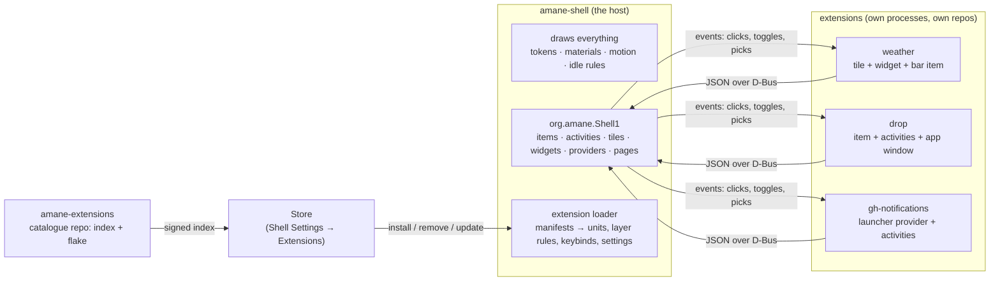

# Extensions plan: the shell as a framework, with a Store

## The question

Rather than rewrite the shell ([rewrite-plan.md](rewrite-plan.md)), could it become a framework:
a core that draws, and features (tiles, widgets, bar items, activities, launcher sources,
Settings pages, whole apps) that live in their own repos, are downloaded from a Store, and can be
written by anyone?

## The answer in short

**Yes, and the shell is already half-way there.** One real extension interface exists today:
`org.amane.StatusBar1` ([status-apps.md](integration/status-apps.md)). Separate programs put
items in the bar and run Live Activities by sending JSON over D-Bus, the bar draws them in its own
look, and the bar follows them off the bus when they quit. Drop and train-watch are built this way.
Everything else (tiles, widgets, indicators, providers, pages) is a compile-time table inside the
shell.

The plan is to **grow that one interface into the extension protocol**, keep the shell as the only
thing that draws, and ship extensions as ordinary programs in their own systemd units. This is the
shape every stable ecosystem converged on (Android widgets, iOS Live Activities, Zed, COSMIC) and the
shape every fragile one lacks (GNOME, Plasma, Hyprland: code loaded into the shell's process,
breaking on each release). The prior art is in §8.

Three things to be clear about up front:

1. **This doesn't make the codebase smaller.** The shell still has to render every tile, widget and
   row, so the host code stays and grows by about 3–4k lines (the protocol, the loader, the Store).
   What it changes is *what has to live in the shell's repo*: features move out, and new ones never
   come in. The quick wins in the rewrite plan are worth doing regardless.
2. **An extension is a process, not a plugin.** No dynamic libraries, no scripts in the shell's
   process. A crash in an extension is that extension's; a shell release can't break one that speaks
   a protocol version the shell still accepts.
3. **Content and code are labelled apart**, in the manifest, the Store and the catalogue. KDE's
   2024 "theme wiped my home directory" incident was a labelling failure: users thought a theme was
   data. Here a *look* (a saved Shader Lab look, an icon set, a layout) never carries code, and a
   *program* extension always says so.



## 1. What exists, and what each kind needs

The inventory, from the code ([status-apps.md](integration/status-apps.md),
`crates/status/src/protocol.rs`, the surfaces' tables):

| Kind | Today | Declarative already | Needs from the protocol |
|---|---|---|---|
| **Bar item** | `ItemSpec`: icon, title, badge, attention, tooltip, menu, drops | 13 of 14 built-in indicators fit | scroll events (volume); `opens: "quick-settings:power"` to open a shell page |
| **Live Activity** | `ActivityContent`: leading icon, title, subtitle, trailing text/countdown/progress, progress bar, ≤3 buttons, tint, dismiss | 3 of 3 built-ins fit | middle-click; a position that ticks |
| **Quick Settings tile** | `controls.rs` `SPECS`, 22 compile-time | 19 of 22 are a `QuickToggle`: glyph, title, subtitle, checked, alert, sizes | a `TileSpec`, `Toggled(bool)`/`Opened` events, the optimistic `Pending` state shown by the host; a pages vocabulary (switch, list rows, segments, slider, footer link) |
| **Widget** | `WidgetKind` enum, 8; fixed `Settings` struct | 7 of 8 are readings in fixed places: figure, label, caption, glyph, ring, bar, sparkline | typed *pieces* at slots per size; settings as a declared schema + JSON values; the host owns `frozen` and animation |
| **Launcher provider** | `Provider` trait, 10 built in, synchronous | 8 of 10 are `Entry` rows: title, subtitle, icon, badge, action, preview | `Search(query, mode) → entries`, `Activate(key)`; results cached by query, never a bus call per frame |
| **Settings page** | `SIDEBAR` table in Shell Settings; System pages already render a registry of controls | the System pages | a page = meta + form rows `{id, title, control, path}` over a `Config` file the shell also reads |
| **Notification handler** | none (the phone's "Open on Phone" is hard-coded) | – | a hook: match on app name/hints → extra buttons `(label, argv)` |
| **App** | own binary on `amane::App`, own unit, own layer rule, `StatusItem` | this *is* the working downloadable shape | a manifest, so the loader generates the unit, layer rule, keybind and Settings page instead of hand copies |

What stays custom-drawn, and so stays in the shell: Now Playing, the Display and Sound slider
cards, the stroke clock, the workspace shape, the assistant. That's three tiles, one widget and one
provider. The rest can leave.

**Cost of an extension today:** train-watch is 611 lines, about 60 of them protocol; Drop is about
1,840, about 50 of them item and menu wiring. A tile-only extension would be under 100.

## 2. The protocol: `org.amane.Shell1`

`org.amane.StatusBar1` is renamed and grown, with the old name kept as an alias for one release.
Every payload stays **one JSON string with a `v`**, as now (`protocol.rs:557`), so a shell script
with `busctl` remains a valid extension.

| Method | Kind | Notes |
|---|---|---|
| `RegisterItem` / `UpdateItem` / `RemoveItem` | bar item | as today, plus `scroll` and `opens` |
| `StartActivity` / `UpdateActivity` / `EndActivity` | activity | as today, plus `middle` and `position` |
| `RegisterTile(spec)` / `UpdateTile` / `RemoveTile` | tile | spec: `id, glyph, title, subtitle, checked, alert, available, sizes, page?` |
| `RegisterWidget(kind)` / `UpdateWidget(id, face)` | widget | `kind`: name, title, blurb, glyph, category, sizes, settings schema; `face`: pieces per size |
| `RegisterProvider(spec)` | launcher | the shell calls back `Search` on the owner's object; `Activate(key)` |
| `RegisterPage(spec)` | Settings | rows over a named `Config` file; Shell Settings draws it |
| `RegisterHandler(match)` | notifications | extra buttons for notifications matching `match` |
| `Features() → s` | – | which kinds and protocol version this shell serves (like `amane::niri::features()`) |

Signals, unicast to the owner as now: `ItemEvent`, `ActivityEvent`, `TileEvent(id, Toggled|Opened|
PageAction)`, `WidgetEvent(id, Pressed|SettingsChanged)`, `ProviderEvent(Activated(key))`.

**Rules, inherited from the bar and from the precedents in §8:**

- **The host renders.** No colours, fonts, sizes or motion cross the bus; a spec names a glyph,
  a tint role (`accent`, `critical`), a size class. The look is always the shell's, so an extension
  can't be off-brand and a token change restyles every extension at once.
- **Versioned and closed.** `v` is required; unknown fields are ignored; a spec newer than the host
  is refused with `Error.Version`. The host keeps the last two majors, as Zed keeps its `since_vX`
  WIT snapshots.
- **Budgeted.** Payloads are clamped (as `protocol.rs:477-495` already does), updates are
  rate-limited per owner (Drop's 150 ms becomes the rule), and the host, not the owner, ticks
  countdowns, progress and sparklines between updates. An extension can't wake the shell every
  frame: the idle baseline ([idle-baseline.md](idle-baseline.md)) stays the acceptance test.
- **Pieces, not drawing.** A widget face is a list of typed pieces (`figure`, `label`, `caption`,
  `glyph`, `ring`, `bar`, `sparkline`, `image`) at the slots a size offers. That covers 7 of 8
  built-in widgets. Custom drawing is not offered; a feature that needs it is a shell feature.

One **Rust crate, `amane-extension`** (today's `amane-status`, grown), holds the types and the
client: `Tile::register`, `Widget::register`, `Provider::serve`. It re-registers everything when
the shell restarts, as the status client does now. It depends on nothing of amane's rendering, so
an extension binary is small and builds fast. Other languages use D-Bus directly.

## 3. The manifest

Each extension ships an `extension.toml`. The loader reads it; nothing else is hand-wired.

```toml
[extension]
id = "org.amane.weather"          # reverse-DNS; never changes (layouts, order and hiding key on it)
name = "Weather"
version = "1.2.0"
kind = "program"                  # or "look", "icons", "layout": content with no code
protocol = "1"                    # the org.amane.Shell1 major it speaks
license = "MIT"
summary = "Conditions and a forecast from Open-Meteo"
homepage = "https://github.com/…/amane-weather"

[program]
exec = "amane-weather"            # started as a user unit, in its own scope, after the shell
restart = "on-failure"
network = true                    # declared, shown in the Store; hardening for the unit follows

[provides]
tiles = ["weather"]
widgets = ["weather.now", "weather.week"]
items = ["weather"]
providers = []
pages = ["weather"]               # drawn by Shell Settings from the spec the program registers

[[keybinds]]                      # offered, not imposed: the user accepts them in the Store
action = "open-forecast"
default = "Mod+Shift+W"

[window]                          # only for an extension with a surface of its own
namespace = "amane-weather"       # the loader generates the niri layer rule
material = "panel"
```

From the manifest the loader generates what today is copied by hand: the systemd user unit, the
niri layer rule (`tokens/layer_rules.rs` becomes the one writer for extensions too), the keybind
proposal, the Settings sidebar entry, and the "seen" lists Shell Settings keeps.

## 4. The loader (in the shell)

A new service, `services/extensions/`, which names no surface (the boundary test holds):

1. **Discover.** Manifests in `$XDG_DATA_DIRS/amane-shell/extensions/*/extension.toml` (system and
   Nix profile), then `$XDG_DATA_HOME/amane-shell/extensions/` (user-installed), later wins.
2. **Check.** Protocol major ≤ host's; id unique; `kind = "program"` has an `exec` on `PATH` or
   beside the manifest.
3. **Enable.** Write `extensions.json` (`Config`, so Settings and the shell both follow it): which
   are enabled, which keybinds accepted. Enabled programs get `amane-ext-<id>.service` under
   `amane-extensions.target`, started after the shell, `Restart=on-failure`, in `app.slice` so a
   shell restart leaves them running (as `amane::launch` already does for apps).
4. **Serve.** The program comes up, registers over `org.amane.Shell1`, and its tiles, widgets and
   items appear where the user had them (layouts already key on the name string, so an extension
   that was missing at boot takes its place back on arrival).
5. **Disable / remove.** Stop the unit; the bus does the rest. Removing a look or icon set is a
   file delete; nothing to stop.

**Content extensions** (`kind = "look" | "icons" | "layout"`) are files only: a saved Shader Lab look
(`kit::lab::look` already loads these), a glyph set, a Quick Settings or widget layout. The loader
makes them selectable in Shell Settings. They are the safe half of the catalogue and the Store
says so.

## 5. The Store

A **Store** section in Shell Settings (not a new binary: one more sidebar group, built from the
same `SIDEBAR` table), with four pages:

- **Browse.** The catalogue index: name, summary, kind badge (*Look* / *Program*), what it provides
  (tile, widget, item…), declared capabilities (network, files, secrets), protocol compatibility
  with this shell, author, licence, last update. Search over words, as the Apps page does.
- **Installed.** Enabled/disabled, version, "update available", the keybinds it offered, its
  Settings page link, Remove.
- **Updates.** From the scheduled check that exists for NixOS (`amane-update-check`), extended to
  the catalogue index.
- **An extension's page.** Screenshots from the catalogue, the full manifest, the repo link,
  *Install* / *Remove* / *Enable*.

The Store's own page for a `program` extension says plainly, above *Install*: "This is a program.
It runs as you and can do what you can." (David Edmundson's lesson, see §8.)

### Installing, on NixOS

Two paths, and the user picks one per machine in the Store's settings; never both for one
extension (the Home Manager experience says the middle is fragile):

| Path | How | For whom |
|---|---|---|
| **Imperative (default).** | `nix profile install github:…/amane-extensions#<id>` into a dedicated profile, `$XDG_STATE_HOME/amane-shell/extensions/profile`, whose `share/amane-shell/extensions/` the loader reads. No root, no rebuild, seconds. Updates are `nix profile upgrade` on that profile. | most users; what "a Store" means |
| **Declarative.** | The Store writes `extensions: ["weather", …]` into `managed/settings.json`; `modules/managed.nix` maps it to `amane.extensions`, which installs the catalogue flake's packages system-wide. Apply builds and activates as today ([nixos.md](integration/nixos.md)). | users who want the machine reproducible from the repo |

Both read the same catalogue flake, so an extension is one derivation either way, and the Store's
index entry carries the flake output name.

**Other distros** come later: the catalogue's CI publishes static binaries per release, signed with
minisign; the loader's user directory accepts them. The protocol and manifest don't change.

## 6. The catalogue: `amane-extensions`

A separate repo, modelled on Zed's and Flathub's indexes:

```
amane-extensions/
  flake.nix            # packages.<system>.<id> for every extension, built from pinned sources
  index.json           # what the Store shows: generated by CI, signed with minisign
  extensions/<id>.toml # one entry per extension: repo, rev, sha256, manifest excerpt, screenshots
  REVIEW.md            # the rules
  .github/workflows/   # build every entry against the current SDK; refuse an index that doesn't build
```

**Submitting** is a pull request adding `extensions/<id>.toml`. CI builds it, runs the manifest
checks, and renders its tiles and widgets in the kit's example harness for a screenshot the
reviewer looks at. Updating is a PR bumping `rev` and `sha256`.

**Review rules** (EGO's list is a good template; short, written down):

- the id is reverse-DNS under a domain or GitHub name the author controls;
- a `program` declares every capability it uses (network, files outside its own dirs, secrets,
  spawning programs), and the Store shows them;
- no obfuscated or minified sources; the build is from source in CI;
- no telemetry without a switch that defaults off;
- it must stop cleanly: leaving the bus leaves nothing behind (the host enforces this anyway);
- an OSI licence;
- a `look` or `icons` entry contains no executable files, checked by CI.

**Trust.** The index is signed with one minisign key whose public half ships in the shell;
verification is offline. Each entry pins a `rev` and `sha256`, so the flake is reproducible and
the Store never fetches a moving branch. Sigstore can replace minisign later if several maintainers
sign.

**Compatibility.** Each entry names the protocol major it speaks. The Store hides entries this
shell can't serve, and the loader refuses them, so a shell upgrade degrades an old extension to
"needs an update" rather than to a crash or a blank tile.

## 7. Phases

| Phase | What | Size |
|---|---|---|
| **0. Pin the protocol** | `Features()`, the version rule (last two majors), rate limits and clamps as policy, `amane-status` → `amane-extension` with the old name re-exported. | S |
| **1. Tiles and bar items** | `RegisterTile` and the toggle vocabulary, `scroll` and `opens` on items. Move **Software Update** and **Weather** out as the first extensions in this repo's `extensions/` folder (still built by this flake), to prove the path with features that exist. | M |
| **2. Manifest and loader** | `extension.toml`, `services/extensions/`, generated units and layer rules, `extensions.json`, the Store's *Installed* page. Drop and train-watch gain manifests and lose their hand-written units. | M |
| **3. Widgets and pages** | widget kinds and faces as pieces; the settings schema; `RegisterPage` drawn by Shell Settings' existing registry renderer (`system/controls.rs`). Move the six readings widgets out. | L |
| **4. Providers and handlers** | `RegisterProvider` with cached async results; the notification handler hook; the phone's "Open on Phone" becomes the phone extension's. | M |
| **5. The catalogue and Store** | the `amane-extensions` repo, CI, signing, the Browse/Updates pages, `nix profile` install, the declarative `amane.extensions` option. | L |
| **6. Contributors** | a `cargo generate` template (`amane-extension-template`: tile + widget + item in 80 lines), `docs/integration/writing-an-extension.md` replacing the status-app guide, the review rules, a *Submit* link in the Store. | S |
| **7. Later** | static binaries for other distros; unit hardening from declared capabilities (`ProtectHome`, `RestrictAddressFamilies`); a WASM host for pure-logic providers (a unit converter, a dictionary) that need no process of their own. | – |

Phases 1–4 each move a built-in out *and* keep it working, so the look stays checkable against the
Phase 0 screenshots of the polish plan at every step, and the idle report shows what a process per
extension costs. If that cost shows, one process may serve several extensions (one manifest, many
`provides`), which the protocol allows from the start.

## 8. What others did, and what to take from it

| System | Mechanism | Isolation | Breaks | Store |
|---|---|---|---|---|
| GNOME Shell | JS patched into the process; no stable API by design | none | every release (ESM port for 45; 48/49 version gates) | human review, written rules, multi-version zips |
| Plasma | QML packages in-process | none | major releases, private imports | unreviewed store; 2024 incident → "dangerous content" labels, apply dialog |
| COSMIC | separate processes on layer-shell, found by `.desktop` keys | process + Wayland security-context | low | none; distro packages |
| Waybar custom | a script printing JSON | process | none | none |
| Hyprland | C++ `.so` per commit hash | none | every commit, dependency ABI drift | `hyprpm` |
| Zed | WASM + versioned WIT; the host renders, the extension never draws | memory sandbox | low | Git index, PR, "untested PRs are closed" |
| Android widgets, iOS Live Activities | declarative snapshot the system renders; budgets (4 KB, 8 h, refresh limits) | process | low | platform store |
| Adaptive Cards | JSON with required `version`, fallbacks, unknown elements ignored | – | low | – |

What this plan takes:

- **From COSMIC:** processes, not plugins; discovery by manifest; one unit per extension.
- **From Android/iOS/Adaptive Cards:** the host renders a closed, versioned vocabulary with
  budgets; the 8-hour cap and the clamps the bar already has.
- **From Zed:** a Git index with PR review; the extension never draws; frozen contract snapshots.
- **From GNOME:** the review rules, and the lesson that "any API, in-process" means every release
  breaks everyone.
- **From KDE:** label content and code apart, in the manifest and on the install button.
- **From Nix:** one derivation per extension in a catalogue flake; imperative installs into a
  profile the loader reads, declarative ones through `managed/settings.json`; never both.

## 9. Risks

| Risk | Answer |
|---|---|
| A process per extension raises idle wakeups and RAM | the protocol lets one process serve many extensions; the host ticks countdowns and sparklines itself; updates are rate-limited; the idle report gates each phase |
| The vocabulary is never enough | it covers 19/22 tiles, 7/8 widgets, 13/14 items, 8/10 providers today; what it doesn't cover stays a shell feature, as on every platform with widgets |
| Protocol churn strands extensions | `v` and `Features()`; the host serves the last two majors; the Store hides what this shell can't serve |
| A malicious or careless program | it runs as the user, like any program the user installs, and the Store says so; declared capabilities, source builds in CI, review, signed index; unit hardening later |
| Settings pages drawn from a spec look different from hand-built ones | the System pages are already drawn from a registry with the same rows; a spec page uses the same renderer |
| The catalogue becomes a second job | PR-based, CI-built, small rules; a maintainer approves, CI does the rest |

## 10. Where to read next

- The interface as it is: [status-apps.md](integration/status-apps.md),
  [its "Writing a status app" section](integration/status-apps.md#writing-a-status-app).
- The NixOS machinery the Store reuses: [nixos.md](integration/nixos.md).
- The idle rules every extension must respect: [performance.md](performance.md),
  [idle-baseline.md](idle-baseline.md).
- The rewrite that this plan replaces, and the quick wins worth doing anyway:
  [rewrite-plan.md](rewrite-plan.md).
