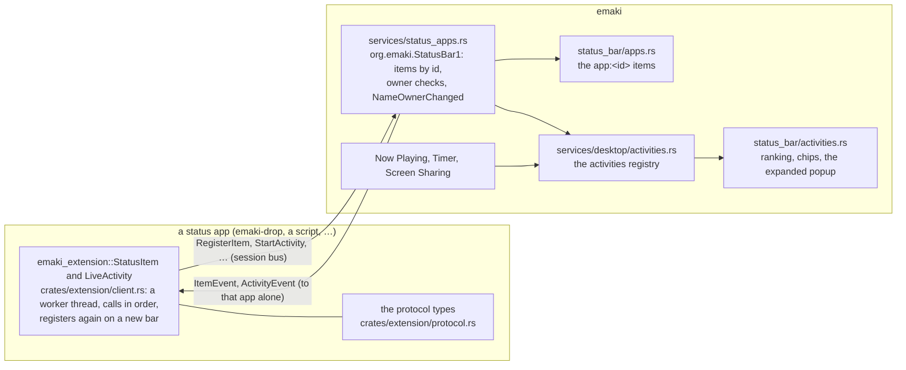

# Status apps and Activities

The bar serves `org.emaki.StatusBar1` on the session bus. Through it, other programs put up
their own items in the bar, and Activities: what's going on now, shown in the bar until it ends.
This page is the whole of it: the protocol, how to write a status app, the rules for Activities,
running one as a service, and how the pieces fit across the repositories. emaki-drop
([drop.md](../../user/features/drop.md), `apps/drop`) is the worked example it points into. What
the bar draws is in [status-bar.md](../../user/features/status-bar.md#programs-items).

Before 2026-11 the bus name was `org.amane.StatusBar1`.

The protocol and its JSON types are one crate, [emaki-extension](../../../crates/extension/README.md)
(`crates/extension`, with the `StatusItem` and `LiveActivity` clients), so a program and the bar
share one definition. Depend on it with `emaki-extension = { workspace = true }` inside this
workspace, or by git from outside it. The server is `apps/shell/src/services/status_apps.rs`.

## Protocol

### From Rust

```rust
use emaki_extension::{ActivityContent, ItemEvent, ItemIcon, ItemSpec, Trailing};
use emaki_extension::{LiveActivity, StatusItem, hello};

// optional: says who it is and learns the shell's level, locale and bar size
let shell = hello("org.emaki.drop");

let icon = ItemIcon::theme("folder-download").or(ItemIcon::glyph("tray"));
let item = StatusItem::register(ItemSpec::new("org.emaki.drop", icon));
item.on_event(|event| { /* Activated, MenuSelected, DroppedFiles, DragHover … */ });

let mut content = ActivityContent::new("Drop", ItemIcon::Glyph("upload".into()), "Uploading");
content.trailing = Trailing::Progress(0.4);
let upload = LiveActivity::start(content);
```

The client sends everything again when the bar restarts. `crates/extension/examples/status_item.rs` is a
whole program.

### From a script

Every payload is one JSON string:

```sh
bus() { busctl --user call org.emaki.StatusBar1 /org/emaki/StatusBar org.emaki.StatusBar1 "$@"; }
bus RegisterItem s '{"id":"demo","icon":{"glyph":"tray"},"title":"Demo","menu":[{"id":"quit","label":"Quit"}]}'
bus StartActivity s '{"app":"Demo","title":"Tea","leading":{"glyph":"timer"},"trailing":{"countdown":1767225600000}}'
```

An item or activity goes when the program that made it leaves the bus. A lone `busctl` call
leaves straight away, so the thing it put up goes with it. A script that keeps one up holds its
connection open, for example a Python `dbus-next` client ([below](#from-another-language)).

### The interface

| Method | In | Out | Errors |
|---|---|---|---|
| `Hello` | `s` hello: `{"v":1,"id":"org.emaki.drop"}` | `s` what the shell serves | `Error.Invalid`, `Error.Level` |
| `RegisterItem` | `s` spec | | `Error.Invalid`, `Error.IdTaken` (another program has the id), `Error.Busy` |
| `UpdateItem` | `s` spec | | `Error.Invalid`, `Error.IdTaken`, `Error.Unknown` (no such item of the caller's), `Error.Busy` |
| `RemoveItem` | `s` id | | `Error.Unknown`, `Error.Busy` |
| `StartActivity` | `s` content | `u` handle | `Error.Invalid`, `Error.Busy` |
| `UpdateActivity` | `u` handle, `s` content, `b` alert | | `Error.Invalid`, `Error.Unknown`, `Error.Busy` |
| `EndActivity` | `u` handle, `s` dismiss (`"now"`, `{"after":5}`; empty is now) | | `Error.Invalid`, `Error.Unknown`, `Error.Busy` |

Errors are under `org.emaki.StatusBar1.Error`. Every payload can also get `Error.Level` (a
`v` this shell doesn't serve) and `Error.TooLarge` (over 64 KB).

`Hello` is optional, so a `busctl` script needs none. It answers with the levels the shell
serves, the kinds it takes, the user's locale and the bar's size:

```json
{"v":1,"oldest":1,"kinds":{"activities":1,"items":1},"locale":"nb_NO.UTF-8","density":"regular"}
```

The Rust client says it again to every bar that starts, and treats a bar from before `Hello` as
serving items and activities at level 1.

### Levels and reading rules

`v` in every payload is the protocol's **level**, an integer; left out, it is the client's.
A shell serves a range, `oldest` to `v` in the `Hello` answer, and refuses a payload outside it
with `Error.Level`. A level is served for two shell minor releases after the next one ships.

What a shell can't read, it drops, and keeps the rest, as Adaptive Cards renderers do:

- **An unknown property** is ignored.
- **An unknown element** (an icon, a trailing kind or a tint this shell doesn't know, a menu
  entry or button it can't read) is dropped, with a warning in the shell's journal. An icon
  becomes the dot, a trailing kind none, a tint the default; a bad menu entry or button is
  left out and its neighbours kept.
- **Too much** is cut where it is read: text to 256 characters, a tooltip to 1024, a menu to
  64 entries a level and 4 levels deep, an activity to 3 buttons.

### Icons

An icon is `{"glyph":"tray"}` (one of the bar's symbols), `{"theme":"folder-download"}` (an icon
theme name), `{"file":"/path/a.svg"}`, or a list tried in order:

```json
{"first_of":[{"theme":"folder-download"},{"file":"/usr/share/drop/drop.svg"},{"glyph":"tray"}]}
```

The bar shows the first it has: a symbol it knows, a theme icon it finds, a file that is there.
A lone glyph it doesn't know is the record dot. In Rust it is
`ItemIcon::theme("folder-download").or(ItemIcon::file(path))`.

### Budgets

Each program is held to these, from `emaki_extension::budget`:

| Budget | Rule |
|---|---|
| Payload | 64 KB of JSON per call, refused over it |
| Updates | one a tenth of a second to each item or activity; more are held and only the latest applied |
| Calls | 20 a second across everything the program put up, refilling steadily |
| Held | 10 updates held at once; one more is `Error.Busy`, and so is putting something up or taking it down with no calls left in the second |
| Activities | 8 hours, then ended; 3 buttons |

A held update answers at once and shows when its time comes; an alert on a replaced update
still alerts. The bar ticks countdowns, count-ups and progress rings itself, so a program
need not send them.

The two signals go only to the program concerned (a unicast signal):

- `ItemEvent(s id, s event)`
- `ActivityEvent(u handle, s event)`

`Introspect` answers on `org.freedesktop.DBus.Introspectable`.

The events are JSON in serde's external tagging, in snake case:

- `{"activated":{"button":"left","x":1532.0,"output":"eDP-1","edge":"top"}}`
- `{"menu_selected":"quit"}`, `{"dropped_files":["/home/me/a.png"]}`, `{"dropped_text":"…"}`
- `{"drag_hover":{"over":true,…}}`, `{"shown":false}`
- for activities, `{"action":"stop"}` or `"dismissed"`

### The shell's side

- **Ownership.** Items are kept by id with the caller's unique bus name. Only that program
  changes or removes an item.
- **Leaving the bus.** The bar follows `NameOwnerChanged` for unique names, and drops a
  program's items and activities when it leaves.
- **Signals out.** `status_apps::send(id, event)` sends an item's events off the event loop.
- **Budgets.** Each program has a `budget::Limiter`, kept by its bus name and dropped when it
  leaves. Held updates are applied by a timer on amane's event loop.
- **Activities.** These go to `services/desktop/activities.rs`. It keeps their handles and
  owners, ends them after 8 hours or when dismissed, and sends `Dismissed` once one has gone.
- **Seen lists.** Emaki Settings lists programs once seen: items in
  `~/.cache/emaki/status-apps-seen.json`, activities' app names in
  `activities-seen.json`.
- **When another program owns the name.** The shell logs it and leaves status apps to that
  program.

Over IPC: `status-bar apps list | activate <id>` and
`status-bar activities list | end bus.<handle>` ([ipc.md](ipc.md#status-bar)).

### From another language

Any D-Bus library works. The payloads are JSON strings, and the program has to stay connected:
its item and activities go away when it leaves the bus. In Python, with `dbus-next`:

```python
import asyncio, json, time
from dbus_next.aio import MessageBus
from dbus_next import Message, MessageType

BAR = dict(destination="org.emaki.StatusBar1", path="/org/emaki/StatusBar",
           interface="org.emaki.StatusBar1")

async def main():
    bus = await MessageBus().connect()

    async def call(member, signature, *body):
        reply = await bus.call(Message(member=member, signature=signature, body=list(body), **BAR))
        if reply.message_type == MessageType.ERROR:
            raise RuntimeError(reply.error_name, reply.body)
        return reply.body

    def heard(message):
        if message.message_type == MessageType.SIGNAL and message.interface == BAR["interface"]:
            # ItemEvent(s id, s json) or ActivityEvent(u handle, s json)
            print(message.member, message.body[0], json.loads(message.body[1]))

    bus.add_message_handler(heard)
    await call("RegisterItem", "s", json.dumps({
        "id": "org.example.tea", "icon": {"glyph": "timer"}, "tooltip": "Tea",
        "menu": [{"id": "quit", "label": "Quit"}]}))
    ends = int(time.time() * 1000) + 3 * 60 * 1000  # three minutes from now, in ms
    [handle] = await call("StartActivity", "s", json.dumps({
        "app": "Tea", "title": "Steeping", "leading": {"glyph": "timer"},
        "trailing": {"countdown": ends}, "tint": "orange", "relevance": 0.7,
        "buttons": [{"id": "stop", "label": "Stop", "destructive": True}]}))
    await asyncio.Event().wait()  # stay on the bus

asyncio.run(main())
```

## Writing a status app

A status app is a program with its own item in the bar, and Activities while something is
going on. It runs on its own and talks to the bar over `org.emaki.StatusBar1`. This section
covers how to build one that behaves like the bar's own items.

### Pick the right surface

| You have | Use | Not |
|---|---|---|
| A place people go to do something: a grid, a list, a control | a **status item**, opening your own window under it | a tray icon: the bar can't place your window or forward drops to a tray icon |
| Something going on now that ends: an upload, a timer, a call, a recording | an **activity**, ended when it's done | a notification for each step |
| Something that happened and is over | a notification (`amane::Notify`) | an activity left on screen |
| A program that already speaks StatusNotifierItem | the tray ([status-bar.md](../../user/features/status-bar.md#apps-the-tray)) | |

An app can have one item and any number of activities. Many apps need only activities: a
recorder can show an activity while it records and have no item at all.

### 1. Put up an item

```rust
use emaki_extension::{Accepts, ItemIcon, ItemSpec, MenuEntry, StatusItem};

let mut spec = ItemSpec::new("org.example.shelf", ItemIcon::Glyph("tray".into()));
spec.tooltip = "Shelf".into();
spec.accepts = Accepts { files: true, text: false };
spec.opens_on_drag = true;
spec.menu = vec![
    MenuEntry::new("open", "Open Shelf"),
    MenuEntry::separator(),
    MenuEntry::new("quit", "Quit Shelf"),
];
let item = StatusItem::register(spec);
```

| Field | What it does | Advice |
|---|---|---|
| `id` | unique on the desktop; the bar keeps its place in `order` as `app:<id>` | a reverse-DNS name; never change it, or the user's ordering and hiding are lost |
| `icon` | `Glyph` (a bar symbol by name), `Theme` (an icon-theme name), or `File` (png or svg) | prefer a `Glyph`: it takes the bar's color, size and attention tint. The names are below |
| `title` | text after the icon, cut at 120 px | leave it empty unless the text *is* the item (a reading, a count) |
| `tooltip` | the hover text | the app's name |
| `menu` | the right-click menu: `id`, `label`, `separator`, `enabled`, `checked`, `destructive`, `icon`, `children` (a submenu) | end it with Quit. With no menu, the right-click comes to you as `Activated { button: Right }` |
| `accepts` | whether files and/or text can be let go on the item | |
| `opens_on_drag` | sends `DragHover` as soon as files come over the item | set it when your window takes drops, so the drag can carry on into it |
| `attention` | shows the icon in the accent | for something that wants the user (a failure), cleared once they look |
| `badge` | a small count | |

Glyph names (`emaki_kit::icons::NAMED`): `dot`, `record`, `timer`, `music`, `play`, `pause`,
`skip-next`, `skip-previous`, `screen-share`, `camera`, `mic`, `upload`, `download`,
`cloud-upload`, `tray`, `share`, `send`, `phone`, `folder`, `image`, `mail`, `terminal`,
`update`, `history`, `check`, `check-circle`, `close`, `warning`, `error`, `copy`, `package`,
`settings`. The bar shows `dot` for an unknown name.

To change anything, send the whole spec again with `item.update(spec)`. Drop rebuilds its spec
from its settings each time (`spec()` and `refresh_item()` in `apps/drop/src/main.rs`).

### 2. Answer its events

```rust
item.on_event(|event| match event {
    ItemEvent::Activated { button: ItemButton::Left, x, output, edge } => toggle(x, output, edge),
    ItemEvent::MenuSelected(id) if id == "quit" => quit(),
    ItemEvent::DroppedFiles(files) => keep(files),
    ItemEvent::DragHover { over: true, x, output, edge } => open_for_drag(x, output, edge),
    ItemEvent::DragHover { over: false, .. } => close_soon_unless_held(),
    ItemEvent::Shown(_) => {} // hidden by the user: keep running
    _ => {}
});
```

Events arrive on a thread of their own. Change your state there, then let a window redraw: put
the state in a `Mutex` behind a kit `marker!`, and call `changed()` after each change. Drop does
this in `state.rs` with `state::change(…)`.

### 3. Open a window under the item

`x` is the item's middle on monitor `output`, in logical pixels, and `edge` is the bar's edge.
Drop's window is a clear, full-screen `Layer::Overlay` surface that draws one card at that
place. Its outside takes clicks, which close it:

```rust
LayerWindow::new()
    .width(WindowSize::Full)
    .height(WindowSize::Full)
    .layer(Layer::Overlay)
    .space(Zone::Ignore)
    .namespace("org.example.shelf")         // needs a niri layer rule, below
    .output(Some(output))
    .keyboard(Keyboard::Exclusive)          // Escape closes; none while a drag is on
    .blur_shapes(vec![Material::Menu.shape(left, top, w, h, 18.0, 1.0)])
    .child(/* the card, padded to (left, top) */)
```

- **Where the card goes.** Center it on `x`, keep it on the screen, and keep it clear of the
  bar: `sys::size::panel::height() + 6` from a top bar, or the same above a bottom one.
  `card_place` in `apps/drop/src/grid.rs` does this, with a test.
- **Frost.** Use a blur shape the size of the card, and a niri `layer-rule` for your namespace.
  For an app in this repo, add the namespace to `apps/shell/src/tokens/layer_rules.rs`, then regenerate the
  rules and splice them into niri's config ([layer-rules.md](layer-rules.md)). For one outside
  it, copy the `emaki.drop` rule from `niri-layer-rule.kdl`.
- **Only quads.** Draw with `Rectangle`, `Text`, glyphs and `Arc`, so nothing goes through vello
  ([performance.md](../performance.md)). Check with `AMANE_FRAMES=1` and the
  `amane/vello-stats` feature: every frame should say `vello 0`.

### 4. Take drags through the item

With `opens_on_drag`, a drag over the item sends `DragHover { over: true }`. Open the window at
once, and the user can carry the files on into it:

- **Don't take the keyboard** (`Keyboard::None`), and give the surface an `input_region` of just
  the card, so the drag can still reach other programs.
- **Close it in a moment** (Drop waits 700 ms) once the files have left the item and the card,
  unless a question is showing. Every drop target in the card reports with `on_files_over`, so
  you know whether anything still holds the files (`state::hover`, `state::drag_left`).
- **Files let go on the item itself** come as `DroppedFiles`. Drop keeps them on its Drop Bar.
- **A click while a drag-opened window shows** turns it into a normal one that takes the keys.

### Checklist

- [ ] A stable reverse-DNS `id`, and a `Glyph` icon.
- [ ] A menu ending in Quit.
- [ ] A window placed under `x` on `output`, clear of the bar, frosted with a blur shape and a
      niri layer rule.
- [ ] With `opens_on_drag`: no keyboard and an input region of just the card while dragging, and
      a close after a grace period.
- [ ] Activities with a short trailing part, honest relevance, alerts only when they matter, and
      ended with `Dismiss::After` ([below](#activities)).
- [ ] Only quads (`vello 0`).
- [ ] Its own systemd user unit, and a `toggle` command for a keybind
      ([below](#running-as-a-service)).
- [ ] Secrets in the keyring, never in arguments.
- [ ] Tested beside the bar without touching the user's clipboard, keyring or phone
      ([below](#testing)).

## Activities

```rust
let mut content = ActivityContent::new("Shelf", ItemIcon::Glyph("cloud-upload".into()), "");
content.title = "Uploading photo.jpg".into();
content.subtitle = "to S3".into();
content.trailing = Trailing::Progress(0.0);
content.progress = Some(0.0);
content.relevance = 0.8;
content.buttons = vec![ActivityButton { destructive: true, ..ActivityButton::new("cancel", "Cancel") }];

let activity = LiveActivity::start(content.clone());
activity.on_event(move |event| if event == ActivityEvent::Action("cancel".into()) { cancel() });
// … as it goes, no more than a few times a second
activity.update(content.clone(), false);
// done: show the outcome, then go
activity.update(finished, false);
activity.end(Dismiss::After(3));
```

These are the bar's rules for activities:

- **Compact is a glance.** The leading picture says what it is. The trailing part is the one
  number that changes: a short text, a countdown, a count-up or a progress ring. Put the rest in
  `title` and `subtitle`, which only the expanded view shows.
- **Let the bar tick.** For a timer, give `Trailing::Countdown(end_ms)` or `CountUp(start_ms)`,
  times in Unix milliseconds, and send nothing until the next real change.
- **Don't update too often.** Drop sends progress at most every 150 ms (`TELL_EVERY` in
  `tasks.rs`). The bar holds anything faster to one update a tenth of a second
  ([budgets](#budgets)), so sending more only costs the program.
- **Alert rarely.** `update(content, true)` opens the expanded view for 4 s (not under Do Not
  Disturb). Keep it for what needs the user now: a call, a finished timer. A normal end isn't
  one.
- **Relevance ranks it** against the others, and only the top ones show compact. For reference:
  Screen Sharing 0.9, Drop's tasks 0.8, the timer 0.7, Now Playing 0.3. Something the user is
  waiting on goes high; background goes low.
- **Up to three buttons**, with the destructive one (Stop, Cancel) marked `destructive`. Their
  presses come back as `ActivityEvent::Action(id)`.
- **End it.** `Dismiss::After(n)` shows the final state (Done, Failed, a link) for `n` seconds.
  Drop uses 3 s, 6 s for a failure, and 8 s when there's a link to open. The bar dims an activity
  past `stale_after` without an update, and ends any after 8 hours. `Dismissed` tells you the
  user ended it.
- **Tint** with a palette name (`orange`, `green`, `red`, `purple`…), so it follows the theme.
  Use one for a state (green when done, red when failed), not for decoration.

## Running as a service

- **One copy.** `App::new().app_id("org-example-shelf")` gives an IPC socket, and a second launch
  hands its arguments to the copy already running (`on_activate`). Register the item only when
  no copy answers, as Drop's `main()` does.
- **Commands.** Offer `toggle`, `open` and `close` over IPC, for a keybind. Drop's niri bind is
  `printf 'toggle\n' | nc -U -N $XDG_RUNTIME_DIR/emaki-drop.sock`, falling back to starting its
  service.
- **Its own service.** Run it as a systemd user unit of its own, not spawned by the shell: a
  restart of the shell kills whatever is in its cgroup. The client puts your item and
  activities back by itself once the bar returns
  ([drop.md](../../user/features/drop.md#installing) has the unit).
- **Quitting.** Remove the item, give the worker a moment to send that, then exit 0. A unit with
  `Restart=on-failure` then stays stopped.
- **The user decides.** An item can be hidden (you get `Shown(false)`), and an app's activities
  can be turned off in Emaki Settings › Status Bar › Activities. Keep working either way.
- **Secrets.** Keep passwords in the keyring, with `emaki_kit::secrets` in this repo or
  `secret-tool`. Never pass one as a program's argument, which `ps` shows: Drop gives curl its
  secrets on standard input (`-K -`).

Shipping a status app in this repository is like any shell change: [release.md](../release.md),
which also says how the flake builds and wraps `emaki-drop`.

## The pieces across repos

This part is for working on the framework itself: how the pieces fit across the
repositories, which thread does what, and how to test it all beside a running desktop without
touching the user's clipboard, keyring or phone.



| Repo | Files | What |
|---|---|---|
| emaki-extension | `crates/extension/src/protocol.rs` | the JSON types (`ItemSpec`, `ItemEvent`, `ActivityContent`, `Trailing`, `Tint`, `Dismiss`…), `Hello`/`ShellInfo`, `encode`/`decode` with clamping and a level check |
| emaki-extension | `crates/extension/src/lenient.rs`, `budget.rs` | unknown elements dropped with a warning; the budget constants and `Limiter` |
| emaki-extension | `crates/extension/src/client.rs` | `StatusItem` and `LiveActivity`: calls in order on amane's control thread (`run_in_order`), events on their own thread, re-registration |
| amane | `src/dbus/bus.rs` | `Bus::emit_to`: a signal to one destination |
| amane | `src/wayland/dropped.rs` | drops read off the event loop (`Drags`, `read_later`, `handle_arrived_drags`), so a slow drag source can't stall the bar |
| emaki-phone | `crates/phone/src/kdeconnect/actions.rs` | `share_files_now`, `share_text_now`: KDE Connect sends that wait and report |
| shell | `apps/shell/src/services/status_apps.rs` | the bus server: methods, ownership, introspection, cleanup when a program leaves, the seen list |
| shell | `apps/shell/src/services/desktop/activities.rs` | the activities registry: handles, owners, ending times, `Dismissed`, the 8-hour end |
| shell | `apps/shell/src/surfaces/status_bar/activities.rs` | the built-in sources, ranking, compact and minimal chips, the expanded popup, alerts, its IPC |
| shell | `apps/shell/src/surfaces/status_bar/apps.rs` | programs' items: picture, title, badge, clicks, menus, drops |
| shell | `apps/shell/src/surfaces/status_bar/indicators.rs`, `drag.rs` | `Item::Activities` and `Item::App`, ordering (`items_with`), hiding, and the `media`/`timer` migration |
| kit | `src/platform/settings/` | `StatusBar` (`activities_*`, `status_bar.rs`), `DropGrids`, `DropTile`, `UploadTo`, `DropSharing` (`drop.rs`), and the seen lists (`seen.rs`) |
| kit | `src/platform/secrets.rs` | secrets through `secret-tool`, with a 0600 file as a fallback |
| kit | `src/foundation/icons.rs` | `NAMED` and `named()`: the glyph names an `ItemIcon::Glyph` may use |
| apps | `apps/drop/` | emaki-drop: `main.rs`, `state.rs`, `grid.rs`, `tasks.rs`, `files.rs`, `share.rs`, `shared.rs` |
| apps | `apps/settings/src/status_bar.rs`, `drop.rs` | Status Bar › Activities, and the Drop page |
| nixos-config | `home/home.nix`, `niri/config.kdl` | the `emaki-drop` user unit, the Mod+Shift+D bind, the `emaki.drop` layer rule |

### How things travel

**A click on a program's item.** `apps.rs` sends `Activated { x, output, edge }` through
`status_apps::send`, off the event loop. It goes as a unicast `ItemEvent` to the item's owner.
The client's event thread calls the handler. Drop calls `state::toggle`, which changes its
`Ui` and calls `Changed::changed()`, and its window redraws. `x` comes from where the item was
laid out (`Laid.start` in `drag.rs`), not from a measurement taken at click time.

**Files dragged over an item.** `on_files_over` sends `DragHover { over: true }`. Drop opens its
grid with `by_drag` set: no keyboard, input only on the card. A drop on a tile reaches Drop's own
window directly; the bar is no longer involved. When nothing holds the files for 700 ms, the grid
closes.

**An activity.** `LiveActivity::start` hands back a handle at once. `StartActivity` goes out on
amane's worker, and later updates queue behind it. The bar's registry assigns the real handle,
and the client maps it. The bar draws from the registry each frame, and a countdown ticks through
`motion::redraw_after` without traffic. A button press goes `registry::act`, then the sink, then
an `ActivityEvent` to the owner. `EndActivity` with `After(n)` keeps it dimmed for `n` seconds,
then `Dismissed` is sent.

**The bar restarts.** The client watches `owner_changes("org.emaki.StatusBar1")`. When a new
owner appears, it sends every item and activity again and maps the new handles. Drop
doesn't notice. Tested: kill the test shell, start it again, and `status-bar apps list` shows
Drop's item again.

**A program leaves.** The server watches `NameOwnerChanged` for unique names and drops that
program's items and activities (`forget`, `end_all_of`).

### Drop's threads

| Thread | Does | Talks to the window through |
|---|---|---|
| the event loop | draws the grid, handles clicks and drops on it | — |
| the bus event thread (amane's client) | item clicks, drags, menu picks | `state::change` → `Changed` |
| one per task (`tasks::run`) | copying, moving, uploading, sending to the phone | `state::change` for the tile's ring; `LiveActivity::update` for the bar |
| curl's readers (`share::run_curl`) | its answer, and its progress bar on stderr | a channel read every 100 ms, which is also when Cancel is checked |
| `secrets::known` lookups (Settings) | `secret-tool lookup` | `SecretsChanged` |

The grids and accounts are amane `Config`s (`drop_grids()`, `drop_sharing()`), followed live
by Drop and Emaki Settings alike. The Drop Bar and Recently Shared are state files that only
Drop writes.

### Testing

Real pointer clicks and drags can't be injected here. Everything else can be driven over IPC,
beside the user's running bar.

#### A test bar and Drop, isolated

```sh
T=$(mktemp -d)                            # short: socket paths must fit in 108 bytes
mkdir -p $T/config $T/state $T/cache $T/data $T/bin
cp -r ~/.config/emaki $T/config/          # then set auto_hide to "never" in status-bar.json
printf '#!/bin/sh\ncat > %s/copied.txt\n' $T > $T/bin/wl-copy   # links land in a file
printf '#!/bin/sh\nexit 1\n' > $T/bin/secret-tool              # secrets go to the 0600 file
chmod +x $T/bin/*
ENV="PATH=$T/bin:$PATH XDG_RUNTIME_DIR=$T WAYLAND_DISPLAY=/run/user/1000/wayland-1 \
     XDG_CONFIG_HOME=$T/config XDG_STATE_HOME=$T/state XDG_CACHE_HOME=$T/cache XDG_DATA_HOME=$T/data"
env $ENV PULSE_SERVER=unix:/run/user/1000/pulse/native PIPEWIRE_RUNTIME_DIR=/run/user/1000 \
    ./target/debug/emaki &
env $ENV ./target/debug/emaki-drop &
```

- **Every XDG folder.** Leave out `XDG_CACHE_HOME` and the first start's move from amane-shell
  renames the real `~/.cache/amane-*` folders under a desktop that still reads them.
- **Inside `nix develop`.** Outside it, the debug build can't find libwayland.
- **The bus.** The real shell build in use may not serve `org.emaki.StatusBar1`, so the test bar
  takes the name on the real session bus. Only one copy can own it.
- **Stopping them.** Find the test processes by the `XDG_RUNTIME_DIR` in `/proc/<pid>/environ`,
  never by name. `pkill -f` on a pattern also matches the shell running the command.
- **Notifications** still reach the real notification server, so set `"notify": false` in the
  test `sharing.json`.

#### Driving it

| Want | Command |
|---|---|
| Drop's item is up | `printf 'status-bar\napps\nlist\n' \| nc -U -N $T/emaki.sock` |
| Click it | `status-bar apps activate org.emaki.drop` |
| Activities going on | `status-bar activities list` |
| Press an activity's button | `status-bar activities press bus.<h> cancel` |
| End one | `status-bar activities end bus.<h>` |
| Open the grid, in edit mode | `printf 'open\n' \| nc -U -N $T/emaki-drop.sock`, or `edit` |
| What a drop on tile 2 does | `printf 'run\n2\n/path/file\n' \| nc -U -N $T/emaki-drop.sock` |
| Hold files on the Drop Bar | `printf 'hold\n/path/a\n/path/b\n' \| nc -U -N $T/emaki-drop.sock` |
| No vello | build with `--features amane/vello-stats`, run with `AMANE_FRAMES=1`: only `vello 0` |

#### Uploads without the internet

`EMAKI_DROP_0X0_URL` points the 0x0.st tile at a local server, and an S3 account's `endpoint`
can be a local one (`http://127.0.0.1:8737`). A small Python `http.server` that answers a POST
with a URL, and a PUT with 200, is enough to check:
- the multipart form;
- the SigV4 `Authorization` header, `x-amz-content-sha256: UNSIGNED-PAYLOAD`, `x-amz-acl` and
  `Content-Type`;
- the link copied, and Recently Shared.

Make it read a path with `slow` in it slowly, to watch the progress ring and try Cancel.

#### Don't

- **Don't run a Send to Phone tile.** If one phone is connected it sends at once, to the user's
  real phone. Test the request with unit tests.
- **Don't use the real `wl-copy` or `secret-tool`** in tests. They write the user's clipboard and
  keyring, and a locked keyring opens a password prompt on their screen.
- **Don't screenshot a window with `niri msg action screenshot-window`.** It always puts the
  picture on the clipboard. `grim -g` on the region works for layer surfaces such as the grid
  and the bar.
- **Crop screenshots** to the card or the bar. The full screen shows whatever the user is
  working on.
- **Don't run `cargo fmt --all` in this repo.** The pinned rustfmt reformats files nobody
  touched. Run `rustfmt --edition 2024` on the files you changed.

#### Unit tests

| Where | Covers |
|---|---|
| emaki-extension `protocol.rs` | round trips, clamping and cutting, a level outside the range refused, an empty id refused, unknown elements dropped, 64 KB refused, icon lists, `Hello` |
| emaki-extension `budget.rs` | updates held and coalesced, merge, busy past the queue, the refill, forgetting |
| shell `services/status_apps.rs` | an id belongs to the program that registered it; a bad payload refused with its own error; busy over the budget; `Hello` answered and forgotten |
| shell `services/desktop/activities.rs` | only the owner changes or ends one; ending later; a program leaving; staleness |
| shell `surfaces/status_bar/activities.rs` | countdown and trailing text; an icon list shows the first the bar has |
| kit `settings.rs` | `items_with`, the migration, the Drop types read as written, `DropSharing::missing` |
| drop `files.rs` | free names, folders copied whole, no half file after a cancel, replace and keep both, a move on one disk |
| drop `tasks.rs` | Rename & Move's names, what a job says |
| drop `share.rs` | curl's progress bar parsed; secrets on stdin and quoted, never in arguments; SFTP and S3 URLs (AWS and another endpoint); Imgur's checks and its link |
| drop `grid.rs` | the card's size and place; buttons wrapping |
| settings `search.rs` | every page, Drop included, can be found |

`cargo test --workspace` in the shell runs them all.
