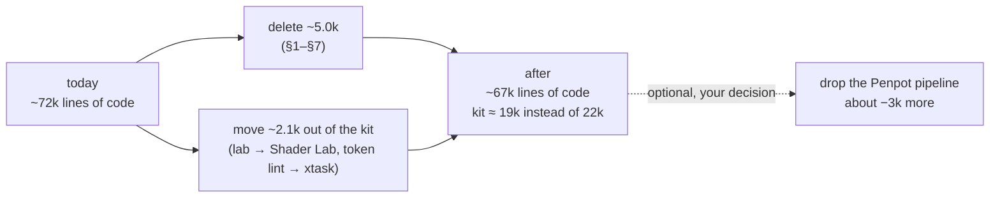
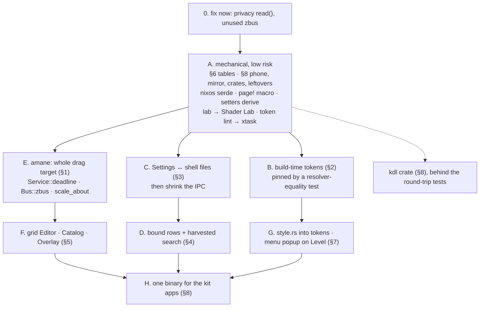

# Rewrite plan: a smaller, simpler shell with the same look

## The question

Could emaki be rewritten so the codebase is smaller and simpler, while keeping every feature
and the look and feel exactly as they are?

## The answer in short

**A ground-up rewrite would not pay.** The workspace has 110,940 lines of Rust. Only about 72k of
them are code; the rest are about 15.4k lines of tests, 12.2k of comments and 11.1k blank lines.
The cleanup roadmap and the [polish plan](polish-plan.md) already removed most of the duplication.
What's left is mostly domain logic that a rewrite would have to carry over line for line:

- monitors: DDC, EDID, HDR and refresh rates;
- NixOS jobs;
- the KDE Connect and scrcpy protocols;
- the pinentry trust chain;
- view code that really does differ from one surface to the next.

Five read-only sweeps (surfaces, services, kit, Emaki Settings, the other apps and crates) found
**about 5,000 lines that can be deleted (about 7% of the code)**, plus about **2,100 lines that
belong somewhere other than the kit**. Most of the savings come from a few structural moves, not
from tidying:

1. **Drags handled once, in amane, rather than in every surface** (§1).
2. **The design tokens worked out when the kit is built, not at run time** (§2).
3. **Emaki Settings and the shell sharing typed files instead of IPC round trips** (§3).
4. **Settings rows that bind to their setting and feed the search index** (§4).
5. **One controller each for grid editing, catalogs and overlays** (§5).

One move would cut much more, about 3,000 lines: dropping the Penpot token pipeline. It goes
against the token manual's first rule, so it is your decision, not a recommendation (§9).

The largest non-code win is **one binary for the kit apps**, which saves about 70 MB on disk and
lets the apps share code pages in memory (§8).



## Where the lines are

| Area | Lines | Deletable | Mostly |
|---|---:|---:|---|
| `apps/shell` surfaces + chrome | 31.6k | ~1,100 | drag machinery, edit/catalog/overlay controllers |
| `apps/shell` services + tokens | 11.2k | ~700 | Tailscale, serde, deadline listeners |
| `crates/kit` (UI) | 22.0k | ~1,200 (+2,100 moved) | build-time tokens, setters |
| `crates/kit/platform` + IPC | 3.6k | ~500 | IPC that shrinks once Settings uses files |
| `apps/settings` + `crates/nixos` | 17.7k | ~1,000 | bound rows, harvested search, `kdl` |
| other apps + small crates | 23k | ~600 | phone getters/calls, mirror, crate merges |

---

## 1. Drags handled once, in amane (−250 to −350 lines; amane +15)

**Today.** amane remembers the dragged target by its index in the last frame
(`amane/src/input/pointer.rs:24`, `dragged: Option<usize>`). A redraw can renumber the targets, so
every surface with drags rebuilds the same machinery around that:

- a still, full-area drag layer: `dock/input.rs:8-90`, `widgets/input.rs:8-27`,
  `customize/drag.rs:68-80`;
- a hit-test list it keeps itself: Quick Settings' `SLOTS` (`edit.rs:59`, `:218-254`), the bar's
  `LAID` (`status_bar/drag.rs:58`, `:178-214`), the gallery's `tile_at` (`gallery.rs:410-424`);
- a movement threshold, a held-item state machine and `swallow_click`. There are four slop
  constants: 6, 6, 6 and 4.

**New shape.** amane keeps the dragged `Target` whole, as it already does for `pressed`, so an item
carries its own drag handlers across redraws. The kit gains one gesture type:

```rust
pub struct Press<K> { from: Point, key: K, moving: bool }
impl<K: Copy> Press<K> {
    pub fn drag(&mut self, at: Point, slop: f32) -> Option<Point>; // Some once past slop
    pub fn release(self) -> Released<K>;                           // Click | Dropped(at)
}
item.on_drag(move |p| held(id, p)).on_release(move |p| dropped(id, p))
```

**Keep:**

- the dock's still layer, for magnification;
- the drop and preview maths (`Session::motion`);
- each surface's own slop value.

**Risk: medium.** It's an amane change, but a small one and cheap to rebase. Every drag needs a
live check: the dock, the bar's order, the widgets and Quick Settings' Customize. See
[testing.md](testing.md).

## 2. Design tokens worked out at build time (−500 to −650 lines in the kit)

**Today.**

- At startup the kit parses `tokens.json`, resolves it for each combination of mode and density,
  caches the result and leaks the tables (`tokens/mod.rs:146-199`). Values are then read by string
  name (`:289-418`).
- There are only 2 modes × 2 densities.
- The expression engine (`expr.rs`, about 280 lines without tests, with trig functions) only ever
  sees `round(N*{R})`, `round({R}*{R})` and `{R}-N`.
- `color.rs` parses `rgb()`, `hsl()` and about 150 CSS colour names, but the JSON is all hex.
  `values.rs` parses token types the JSON never uses.

**New shape.** `build.rs` already reads the JSON with the kit's parser. It goes one step further:
it resolves the four combinations and writes plain values out.

```rust
pub fn m() -> f32 { pick([8.0, 8.0, 7.0, 7.0]) }   // [mode × density]
pub fn bg() -> Color { accent(Slot::Seed) }        // follows the accent
pub fn label() -> TextStyle { scaled(LABEL[idx()]) }
```

What else changes:

- The parser and resolver become build-only. The run-time JSON parse, `current()`, `resolved()`,
  `Resolved` and the `read` module go.
- The expression engine is cut down to `round`, `*` and `-`. A new expression form fails the build
  loudly.
- The generator writes accessors keyed by control size. That removes the six five-arm `match`es in
  `control_size.rs` (about 90 lines).
- The seven copies of "read an environment override once" in `theme.rs:90-195` become one helper.

**Risk: low.** A test keeps the old resolver and checks that every generated value equals what it
resolves today.

**Moves with it:** the token `lint.rs` (747 lines) and `check.rs` (86) go to `xtask/src/tokens/`.
Only xtask calls them, through the `tools` feature.

## 3. Settings and the shell share typed files, not IPC round trips (−500 lines)

**Today.**

- **Night light:**
  - Emaki Settings works out the shell's state-file path (`displays/night.rs:92`).
  - It sends `night-light state`, gets back a line like `on 4000 hours 21:00 07:00`, and parses
    it with its own copy of `Schedule` (`night.rs:98-162`).
  - The shell has the other half: `night_light.rs:58-90` and `:230-380`.
- **Quick Settings:** Settings does the same with a tab-separated `shown` reply
  (`apps/settings/src/quick_settings.rs:75-100`).
- **Where `ShellCommand` lives:** in the kit (`shell_ipc.rs`, 894 lines), mainly because Settings
  sends it.

**New shape.**

```rust
settings_file!(NightLightPrefs, SHELL, "night-light", night_light, change_night_light);
// the shell:  Config::<NightLightPrefs>::subscribe(apply)
// Settings:   change_night_light(|n| n.temperature = k)
```

- The same goes for which Quick Settings controls are hidden.
- The `night-light …` verbs stay for keybinds, as thin writes to the file.
- One `Schedule` type, in the kit.
- With few verbs left that Settings sends, `ShellCommand` moves into the shell and parses straight
  into the handlers. `to_lines` (`shell_ipc.rs:575-748`) shrinks to the verbs Settings still sends
  (Passwords and `Widgets::Edit`).
- Phase 4a declined a table that generates both `parse` and `to_lines`. That was right then. The
  change here is different: most of `to_lines` simply goes.

**Risk: low to medium.**

- There are now two writers to one file. `Config::change` reads and writes in one step, so the
  window for a race is tiny.
- `night-light.json` changes format, and its legacy reader already exists.
- The verbs scripts use don't change. The `LINES` test stays, for parsing only.

## 4. Settings rows that bind and index themselves (−650 lines in Settings)

**Today.**

- **Each page by hand:** a page reads its file, builds each control itself and wires it with a
  `change_x(|now| …)` closure. That's 69 closures, 32 `switch_row`s, 21 dropdowns, 6 copies of the
  `ThumbnailPicker` sequence and 19 literal widths.
- **Search by hand:** `search.rs:62-465` copies 61 row titles and their words, and a test that
  greps the source keeps them in step (`:630`).
- **Already data:** the System pages are built from the NixOS registry, so that half is already
  data.

**New shape.**

```rust
macro_rules! field { ($f:ident) => ((|t| t.$f.clone(), |t, v| t.$f = v)) }
let bar = Bound::<StatusBar>::now();
bar.switch("settings.bar.workspaces", "Show workspaces", field!(show_workspaces));
bar.choice("settings.bar.size", "Size", BarSize::ALL.map(|s| (s.label(), s)), field!(size))
   .found_as("Bar size").found_by(&["height"]);
bar.picker("settings.bar.material", "Look", STYLES, previews::bar, field!(style))
   .disabled_if(|b| !b.show_workspaces);
```

- **Search:** `groups()` records each row's place, id, title and words while `search::harvest()`
  builds each page once (and its sub-pages). The copied index and the source-grep test go, and a
  structural test replaces them.
- **What this covers:** Phase 6's `picker_row` and `content_width`. It also shortens
  `appearance::page` (195 lines) to under 100.
- **Why not a full `const` schema:** only about 63 of the 133 rows are plain bound controls. The
  rest (links with summaries, the Displays rows, lists, dialogs) would each need a custom escape
  hatch.
- **The pages table:** a `page!` macro for `pages::SIDEBAR` (`pages.rs:116-386`) saves another
  ~150 lines.

**Risk: low to medium.**

- **Hardware-only rows:** rows that show only on some hardware (HDR, OLED, DDC) drop out of search
  when they aren't shown. That's a visible change, and arguably the right one.
- **Starting services:** harvesting must not start a service's listener (DDC probing,
  `nix eval`), so it builds pages in a "peek only" mode.
- **Control ids:** the derived ids change from `settings.mode` to `settings.appearance.mode`. That
  resets only transient dropdown state.

## 5. One controller each for grid edit, catalogs and overlays (−550 to −650 lines)

Phase 3 shared the *drawing* of these. The *state machines* around them are still near-copies.

**Grid editing (−250).** Quick Settings (`edit.rs:50-345`) and the widgets (`edit.rs:55-262`,
`input.rs:31-137`) each do the same steps:

- begin a session;
- press, pass the threshold, then move;
- a handle resizes;
- release off the canvas removes the item; otherwise it snaps (`motion::jump`) and commits;
- an undo snapshot;
- a lift from the catalog.

The new shape lives in `chrome`, since the kit's grid stays pure:

```rust
pub struct Editor<K: GridKey, U = ()> { session: Option<Session<K>>, press: Option<Press<K>>,
    undo: Option<(Layout<K>, U)>, marks: Animation }
pub trait Canvas<K> { fn layout(&self) -> Layout<K>; fn commit(&mut self, l: Layout<K>);
    fn remove(&mut self, k: K) -> U; fn restore(&mut self, u: U); fn metrics(&self) -> Metrics; }
```

Some things only the widgets do: they drag between cells outside edit mode, are edited per monitor,
and their undo carries widget settings. These become parameters of the editor, not branches.

**Catalogs (−150).** Customize and the widget gallery share `chrome::catalog::Sheet`, but each
still keeps its own:

- field, section and tile list;
- a `motion::pop` + `OPENING` pair (`gallery.rs:123`, `customize/mod.rs:92`);
- `clear_query`, `key`, `pick` and `tile_at`;
- the swell and frost frame.

A `Catalog<S, K>` owns all of that. Scrolling (only Customize scrolls) and reset-on-open (only the
gallery resets) become options on it.

**Overlays (−150 to −200).** Quick Settings, the launcher, the alert and the OSD each write the
same per-frame cycle:

1. watch;
2. step the `Reveal`;
3. check `showing`;
4. reset each cell when hidden, or draw a `Swell` with frost.

The OSD, Customize and the gallery still keep their own `Animation` + `OPENING`, where they should
use `Reveal`.

```rust
trait Overlay: Default {               // Default is the hidden state
    const NS: &'static str; const FROM_SCALE: f32;
    fn open(&self) -> bool; fn window(&self) -> LayerWindow;
    fn view(&mut self, s: Swell) -> (Box<dyn Widget>, Vec<BlurShape>);
}
fn drive<O: Overlay>(cell: &RefCell<(O, Reveal)>) -> LayerWindow;
// plus Reveal::timed(open, close) for the OSD, Customize and the gallery
```

**What it does:** `hidden()` becomes `*state = O::default()`, so the per-cell resets go. This also
takes most of the 41 `thread_local!` blocks down to one cell per surface.

**What it leaves out:** the notification center stays on its own, because its keyboard follows the
slide.

**Hooks:** each quirk becomes a hook:
- Quick Settings' cascade;
- the alert clearing `SHOWN` only after it has closed;
- the OSD's linger.

**Risk: medium.** Check the open and close motion against the Phase 0 screenshots.

## 6. Tables for what is still mirrored (−250 lines)

| What | Today | New shape | Lines |
|---|---|---|---:|
| Bar items | `Item` (14) and `Indicator` (16) with parallel `ALL`, `name`, `named` and a mapping (`indicators.rs:15-230`), plus the `build` match | `const ITEMS: [ItemSpec; 16]` with `name`, `hideable` and `build`. The names stay; they are keys in `status-bar.json` and IPC words | −100 |
| Quick Settings pages | five parallel matches in `pages.rs` (`:33`, `:63`, `:91`, `:112`, `:135`) | `PAGES: [PageSpec]` with `grows_from` and `gated_by` as separate fields (Session grows from PowerOff but isn't gated by it) | −50 |
| Monitors | 34 `output.to_string()`/`.clone()` sites | `Output(&'static str)` from `intern`, `Copy`, as the key of `PerOutput` | −50 |
| Panel IPC | open/toggle/close-if-open in three `ipc.rs` files; "unknown X; one of …" written 4 times | `panel::run(Panel, Action)`, `named_or_usage(name, ALL, what)` | −30 |
| Pivot scaling | 7 hand-written scale-about-a-point sites | `.scale_about(s, pivot)` on `Rectangle` (a small amane addition). Check the pixels | −25 |

## 7. Services and the kit's builders (−1,000 lines)

**Services (−700).** Each change, with its risk:

- **Tailscale on the LocalAPI only.** Today every read has two paths, socket or CLI
  (`tailscale.rs:309-330`). There's a CLI `watch-ipn` fallback, writes go through the CLI, stderr
  is parsed for refusals, and `Value` is walked by hand (`:470-552`). The CLI is itself a LocalAPI
  client, so the fallback buys nothing. Use typed `get::<Status>` and `patch(MaskedPrefs)` instead.
  *−180. Medium risk: the LocalAPI isn't stable across Tailscale versions.*
- **serde derives instead of `Value` walking.** In rbw (`#[serde(untagged)] enum Uri`), weather,
  `pw-dump` and background apps. *−80, low risk.*
- **One way to follow a program's output.** `Cmd::follow_lines`, and `kit::fetch(url)` for the two
  hand-written `curl`s. This replaces the 15 raw `Command::new` sites. *−70, low risk.*
- **Deadline-driven `listen()` in amane.** A default `Service::deadline()` plus `nudge()` replaces
  the "wait for a deadline or a nudge" loops in Do Not Disturb, keep-awake, the clock and weather.
  The vault's own Condvar wake goes too, and `wake.rs` moves into amane. *−60 net, amane +30, low
  risk.*
- **A typed D-Bus server for `org.emaki.StatusBar1`.** zbus `#[interface]` replaces the
  hand-written introspection XML and method dispatch (`status_apps.rs:29-230`). It needs
  `Bus::zbus()`, a one-line amane change. *−100. Medium risk: it shares amane's connection.*
- **One helper for short actions**, so fire-and-forget calls log their failures the same way.
  *−40, low risk.*
- **Old state readers.** The legacy readers marked "delete after 2027-01" go on that date
  (`state.rs:117` and 8 `legacy()` impls). *−120, no risk.*

**Kit builders (−300 to −430).** 144 of the kit's 157 `(mut self)` setters are trivial
(`self.x = v; self`). A `#[derive(Setters)]` with the docs on the fields replaces them. Setters
that wrap a callback in `Rc`, or that do real work, stay hand-written. Phase 4a declined a macro
for the IPC because that grammar was irregular; these setters are all the same shape, so the
objection doesn't carry over.

**Kit, smaller items:**

- **`style.rs` into tokens (−100).** It hard-codes colours with light twins and scales sizes with
  `px(v) = v * density`, which never rounds. Add `form.*` component tokens without `round()`, so
  sizes stay identical, and drop `Material::label`/`fill_role`/`separator`'s ignored argument.
  *Moderate risk in compact density.*
- **The menu popup on `stack.rs`'s `Level` (−120).** It stops keeping its own focus and keys apart
  from `layer.rs`. *Check live: the two close and refocus slightly differently.*
- **`look/lab` moves to Shader Lab.** It's 1,268 lines that only Shader Lab uses. It's a move, not
  a deletion.

## 8. The other apps, crates and binaries (−600 lines, −70 MB)

- **Phone crate (−300):**
  - The 64 one-line getters become public fields; the data is only seen through
    `Service::read()` anyway.
  - `kc::call(device, sub, iface, method, args)` replaces 21 raw seven-to-nine-line `try_call`s.
  - A positional reader on `Value` replaces the hand-indexed struct decoding in `sms.rs`.
- **Mirror (−100):**
  - A blocking `read_exact` decoder replaces the incremental "not all there yet" buffer
    (`session.rs:183-206`, `protocol.rs:348-388`).
  - One `read_packet` serves video and audio.
  - It uses `app_window` and its token background.
- **Crates (−60, two crates fewer):** `emaki_base::{log, process}` takes `crates/log` (87 lines) and
  `crates/process` (421). `status`, `assistant` and `pinentry` stay separate, for train-watch,
  the daemon protocol and auditing.
- **Leftovers (−40):** Drop's identical `run`/`hold` handlers, its own percent encoder and
  weather's; the status crate's five `decode`s.
- **Emaki Settings and nixos (−300):**
  - **`displays/kdl.rs` on the `kdl` crate.** It saves −150, and it fixes a real fragility: the
    line-based reader breaks on one-line nodes, multi-line strings or `/-` comments. *Medium risk:
    niri's knuffel reads KDL v1 and the crate defaults to v2. The round-trip tests guard it.*
  - **`nixos/settings.rs` on serde derives (−90):** `#[serde(tag = "control")]`, with an
    `#[serde(other)]` fallback so one bad entry is still skipped.
  - **One `Latest<T>` for the three "latest wins" loaders, and `apply_bar` (206 lines) as a match
    from phase to text and buttons (−90).**
- **One binary for the kit apps.** Today the shell (32 MB), Settings (28 MB), Drop, Messages and
  Shader Lab (24 MB each) each link their own amane, wgpu and vello. Each app would become a
  library with `pub fn main()`, and one binary would pick the app by the name it's run as. The
  flake keeps one wrapper per name, so app ids, `.desktop` files and units don't change. They stay
  separate processes.
  - *Saves about 70 MB on disk and three amane links per build, and lets running apps share code
    pages. Fits [memory.md](memory.md).*
  - *Mirror (ffmpeg), the assistant (its own crash domain), pinentry and train-watch stay
    separate.*

## 9. Your decision: drop the Penpot pipeline (about −3,000 lines)

What it would replace with a token file written in Rust (about 600 lines):

- `tokens.json` (1,998 lines);
- the parser, resolver, expression engine, values, generator and lint (about 2,600 lines, plus
  about 790 of tests).

It ends rule 1 of the token manual, "Penpot is the source of truth", and its CI checks. It's only
worth it if the Penpot round trip isn't in use any more. §2 keeps Penpot and still takes most of
the run-time cost.

---

## What stays as it is

| Area | Why |
|---|---|
| The vault (2.1k) and pinentry (0.9k) | the trust chain and identity checks are deliberate security invariants |
| `displays/sections.rs` (1.3k) | per-output hardware logic; a schema doesn't fit |
| `layer_rules.rs` (857) | 593 of its lines are tests |
| `system_stats` | it does more than amane's `Cpu`/`Memory` (per-core figures, history) |
| The long drawing functions | splitting them moves lines without removing any (Phase 7) |
| Drags across surfaces | amane would have to carry a drag between surfaces; too costly to rebase |
| One glyph and tooltip derivation for the bar and Quick Settings | the copies differ on purpose ("Bluetooth on" against "On") |
| `text_edit::Field` against amane's field | amane's has word movement, which would change the launcher's keys |
| Night light on `wlsunset` | native gamma control would be a large amane addition |
| zbus `#[proxy]` for KDE Connect | it needs a second connection, and signals still arrive as amane `Value`s |
| Examples (825) | they are the screenshot harness for the visual check |

## Fix now, independent of the plan

- **The idle bug, once more.** `services/desktop/privacy.rs:60,67` still calls `Privacy::read()`
  inside its listener. That's the bug Phase 5 fixed everywhere else. Use `ServiceExt::replace`, and
  extend the hygiene check so it catches this case.
- **An unused dependency.** `apps/shell/Cargo.toml:35` keeps `zbus` for logind's Inhibit, which
  `Logind::inhibit` now does, and nothing in `apps/shell/src` uses it.

## Order



- **Each step:** one commit that builds and passes CI:
  `cargo fmt --all --check && cargo clippy --workspace --all-targets -- -D warnings && cargo test --workspace`,
  plus `cargo xtask layer-rules`, `lint-terms` and `links`.
- **The amane steps (E):** they go on the `ocbk` branch as small, separate commits, so rebases stay
  cheap. Each is listed in [contract.md](integration/contract.md).

## Checking that nothing changed

- **Look:**
  - Compare against the polish plan's Phase 0 screenshots after B, F and G.
  - B also has its resolver-equality test.
  - G needs checking in compact density.
- **Feel:**
  - Live drag tests on the dock, bar order, widgets and Customize after E and F.
  - Overlay open and close motion after F.
  - Run the examples beside the running bar.
- **Behaviour:**
  - Unchanged: the `LINES` round trip (parse only, after C) and the KDL round-trip tests.
  - New: a structural search test after D.
- **Idle:** `idle-report` after C and E. Wakeups and spawns should be no higher than in
  [idle-baseline.md](idle-baseline.md).
- **Visible changes allowed:**
  - Search no longer lists hardware rows the machine doesn't have.
  - Dropdowns and pickers lose their transient open/scroll state when their derived ids change,
    once.
