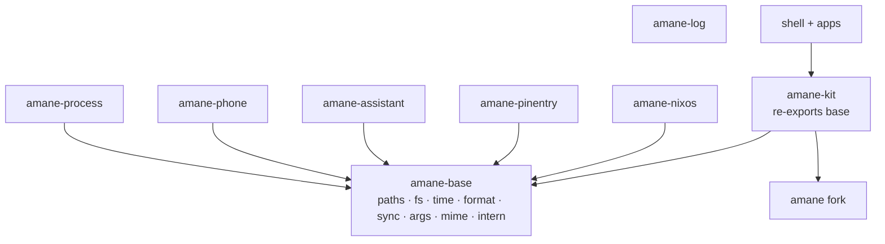

# Polish plan: one copy of everything

## Context

The cleanup roadmap (`docs/archive/ROADMAP.md`, Phases 0–13, finished 2026-11-07) fixed the layers: crates, surface folders, typed IPC, state files, one menu, logging. What it left is duplication *inside* those layers. Three read-only sweeps of the workspace (110k lines) found roughly 2,500–3,000 removable lines. The duplication comes from four sources:

1. **Missing foundation.** About 20 helpers (XDG paths, writing a file whole, "x ago", byte sizes, unix time, poison-safe locks, `--flag` parsing, MIME lookup, string interning) are written 2–12 times each. The cause: `phone`, `assistant` and `pinentry` can't depend on the kit, and nothing below the kit holds them.
2. **Missing primitives.** The kit lacks a few small building blocks, so every surface rebuilds them: a fixed-size frame (~108 sites), a reveal "swell" (6 sites), a press action (18 sites), a pressable row, a scroll pane, edit-mode chrome, and a catalog sheet. Customize and the widget gallery are near-copies of each other.
3. **Hand-mirrored tables.** One fact is written several times and kept in step by hand:
   - IPC: `parse` and `to_lines` mirror each other, ~390 lines.
   - Shell Settings: the page list is written in 7 places, and `search.rs` copies the titles.
   - Quick Settings: the controls are spread over 7 parallel `match`es.
   - Choice enums: 22 `ALL` arrays.
4. **Missing service helpers.** The same plumbing is repeated across services, and it hides a real bug: listeners call `read()` where they should call `peek()`, which counts as being watched and defeats idle-stop. Affected: weather, background apps, tailscale, Do Not Disturb, night light, keep-awake.

**Outcome:** one copy of each helper, data-driven tables where facts used to be mirrored, the kit as the single place for UI idioms, and lints that keep it this way.

**Decisions:**
- **New crate:** a std-only `amane-base`.
- **Visible changes:** allowed where copies disagree today. Each one is listed in §Visible changes.
- **Constraints:**
  - Forks stay cheap to rebase, so no new amane API: service helpers are kit extension traits.
  - New UI stays on the quad pipeline.
  - Diagrams in docs are mermaid.
- **Commits:** each step is one commit that builds and passes CI.

## Target shape

---

## Phase 0: Baseline (S)

**Status (2026-11-07).** Done at shell `e7a0831`: clippy clean, 712 tests pass.

| Crate | Lines |  | Crate | Lines |
|---|---:|---|---|---:|
| apps/shell | 44,326 | | crates/kit | 25,775 |
| apps/settings | 15,244 | | crates/phone | 4,240 |
| apps/messages | 3,334 | | crates/nixos | 2,582 |
| apps/drop | 3,327 | | crates/assistant | 1,759 |
| apps/shader-lab | 3,054 | | crates/status | 1,091 |
| apps/mirror | 2,834 | | crates/pinentry | 926 |
| apps/assistant | 1,103 | | crates/process | 423 |
| apps/train-watch | 628 | | crates/log | 87 |

110,733 lines of Rust in all; 93 files over 400 lines; 103 poison-tolerant lock spellings; 576
`Size::Fixed(` wrappers.

- Record the metrics: line counts per crate and files over 400 lines. Confirm that `cargo clippy --workspace --all-targets -D warnings` and `cargo test --workspace` are green.
- Take screenshots for later comparison:
  - the bar, Quick Settings (grid, Customize, the Bluetooth and Phone pages), the widget gallery and edit mode, the launcher, and the OSD;
  - the Shell Settings pages (Appearance, Status Bar, Displays, System → Apps);
  - Drop, Messages and Shader Lab.
- Land this plan as `shell/docs/development/polish-plan.md`. It moves to `docs/archive/` when finished, as the roadmap did.

## Phase 1: `amane-base`, the one copy of each helper (M)

**New crate `crates/base` (std only, plus `serde`/`serde_json` for `fs::save_json`):**

| Module | Contents | Replaces |
|---|---|---|
| `paths` | moved from `kit/src/foundation/paths.rs`, which the kit now re-exports | `phone/kdeconnect/{config,files,contacts}.rs`, `assistant/lib.rs:49`, `pinentry/peer.rs:16`, `apps/assistant/main.rs:56`, `train-watch/main.rs:74`, `shell/services/vault/rbw.rs:125`, `messages/phone.rs:15` |
| `fs` | `write_whole(path, bytes, Write { fsync, private })` and `save_json(path, &T)` (pretty, logs on failure) | `kit/look/glass.rs:172`, `kit/platform/secrets.rs:170`, `nixos/{settings,catalog}.rs`, `phone/kdeconnect/files.rs:43`, `drop/{shared,state}.rs`, `mirror/apps.rs:71`, `shader-lab/configs.rs:104`, `settings/system/defaults.rs:408`, `settings/displays/kdl.rs:566`, the three save blocks in `kit/platform/settings/seen.rs` |
| `time` | `unix_ms()`, `unix_s()` | 6 copies (`sms.rs:1151`, `activities.rs:228`, `file_search.rs:471`, `usage.rs:130`, `clipboard_history.rs:421`, `phone/apps.rs:70`) |
| `format` | `ago(Duration)`, `span(Duration)` ("2 h 5 min"), `bytes(u64)`, `count(n, one, many)` | the "ago" copies (`nixos/lock.rs:24`, `settings/system/update.rs:126`, `passwords.rs:213`, `launcher/model.rs:333`, `notifications/card/parts.rs:134`); h/min in `tiles/power.rs:161`, `tiles/keep_awake.rs:21`, `catalog/battery.rs:81`, `train-watch/log.rs:188`; bytes in `storage.rs:32`, `catalog/system.rs:22`, `launcher/model.rs:342`; plurals in 4 sites |
| `sync` | `trait LockExt { fn locked(&self) -> MutexGuard<T> }` for `Mutex` and `RwLock` | about 76 `unwrap_or_else(PoisonError::into_inner)` / `\|e\| e.into_inner()` sites, and `assistant.rs:74` `state()` |
| `args` | `flag(&args, name)`, accepting both `--n=v` and `--n v` | 5 copies with 3 behaviours (settings, messages, mirror ×2, shader-lab) |
| `mime` | `mime(path)`, `is_image(path)` | `drop/share.rs:91`, `drop/grid.rs:1399`, `messages/compose.rs:263`, `phone/sms.rs:156`, `launcher/provider/files.rs:97` |
| `percent` | `encode` / `decode` | `media_art.rs:91`, `file_search.rs:423`, `rbw.rs:180`, `launcher/model.rs:263` |
| `intern` | `intern(String) -> &'static str`: one bounded leak, deduped through a set | `shader-lab/panel.rs:1031`, `settings/main.rs:552`, `settings/system/controls.rs:82`, `kit/color_picker/mod.rs:390`, `status_bar/indicators.rs:120`, `widgets/mod.rs:222` |

- **`app_ids`:** move from the kit to base, so that `amane_log::init(app_ids::SHELL)` works in the crates that don't use the kit. This replaces the 9+ `"amane-shell"` literals.
- **Hex colours:** keep the kit's `tokens::color` parser as the only one. `color_picker` and `settings/appearance.rs:73` call it.
- **Opening files:** add `kit::open(path_or_uri)` on one launch API, for the 12 `xdg-open` sites.

**Lands as four commits:**
1. The crate and its tests.
2. The kit re-exports base, and kit-internal sites move onto it.
3. The non-kit crates move onto it.
4. The shell and apps move onto it, and every copy is deleted.

## Phase 2: Kit interaction core (M)

- **`Actions`:**
  - `Actions::press(f)`, plus `on_hold` / `on_release`. This replaces the 18 `Actions { press: Some(Rc::new(..)), ..Default::default() }` sites, `parts::on_press`, and `fill/view.rs:357`.
  - The stepper drops its hand-wired hold (`stepper.rs:200-225`).
- **One hover layer:**
  - `hover::layer(id, fill, Tone)` built on one `fade`; `buttons::state_fill` and `hover::hover_fill` both go.
  - The `.mac-hover` key is retired.
  - One `DISABLED_OPACITY` token replaces 0.38, 0.5 and the literal in `form.rs:398`.
- **One pressable row:** `pressable(rect, id, base_fill, disabled, Option<Actions>)`, used by `containers/list.rs:219`, `containers/form.rs:367`, `platform/app.rs:258` and `menu/popup.rs:405`.
- **Checkbox and radio become one `Mark { Check | Radio }`.**
  - It reads `control_size::current()`, which removes the literal `px(16)`/`5.5`/`4.8` (also in `parts::labelled`).
  - `ControlSize::checkbox()` and `radio_dot()` finally have users.
- **Round glyph buttons:** `pop_up_button`, `nav_buttons` and the stepper halves become an `IconButton` form variant.
- **`look/style.rs`:**
  - Delete the nine pure-alias functions; call sites use `sys::` directly.
  - Delete the dead `knob()` and `error()` (the latter hard-codes `#ff6961`).
- **API consistency:**
  - Every control id takes `impl Into<String>` (`Stepper` didn't).
  - Every control uses `disabled(bool)` (`NavButtons` had `back_enabled`).
  - `Slider` gets an id.
- **Named motion constants:**
  - `popup.rs` drops its `FADE` and uses `motion::FADE`.
  - The 300 ms crossfade and the 250 ms swallow window get names.
  - `held()` and `pressed()` share one timeout, and their docs are fixed to match it.
- **Delete unused public items:** `ListItem::leading_tile_accent`, `Launcher::keys_for`.
- **`pad_x(l, r)`:** a helper beside `layout::pad`, for the ~12 hand-built `Padding {..}`.

## Phase 3: Layout, motion and container primitives (M)

**Layout:**
- `layout::frame(w, h)` (a transparent fixed box) and `layout::place(widget, x, y, w, h)`, promoted from `widgets/catalog/mod.rs:85`.
- A mechanical pass deletes the needless `Size::Fixed(..)` wrappers (254 of them; `From<f32> for Size` exists in `amane/src/placement.rs:154`).

**`Area`:** a kit pixel-rect type with `contains`, `centre`, `scaled`, `clipped`. It replaces the 5 rect structs (`customize/mod.rs:77`, `gallery.rs:48`, `launcher/shape.rs:28`, `quick_settings/mod.rs:300`, and grid `Slot` as a newtype). Alongside it:
- `Rim::scaled`
- `Material::shape_of(&Rim)` (from `tiles/mod.rs:399`)
- the "scale about the centre" copies in `tiles/mod.rs:261,318`, `widgets/view.rs:164` and `customize/drag.rs:96` move onto `Area::scaled`.

**`Reveal`:**
- It gains `visible()` and `swell(from_scale) -> Swell { scale, opacity, frost }`.
- The 6 hand-written swells (alert, launcher, customize, gallery, OSD, Quick Settings) use it.
- Customize, the gallery and the OSD drop their own `Animation` plus `OPENING` copies of `Reveal`.
- The ~10 `0.001`/`0.999` checks become `visible()`.
- `OPEN_SCALE` comes from the token everywhere.

**Motion:** `motion::ease(dur)` and `motion::spring_for(dur, bounce)`, which respect reduced motion. Used by `status_bar/mod.rs:101`, `workspace_shape.rs:267` and `dock/motion.rs:165`.

**Containers:**
- **`ScrollPane { kinetic, bar }`** with `wheel`, `reset`, `opacity`, and one `WHEEL_STEP`. Used by the launcher and Customize.
- **`grid::edit`:** `remove_badge`, `resize_handle`, `drop_outline`, `BAND`, taken from `quick_settings/edit.rs:359-500` and `widgets/edit.rs:267-356`.
- **`CatalogSheet` and `catalog_item(preview, w, h, title)`:** the sidebar with search, the pane, and the footer (hint, Undo Remove, Reset, Done). Customize and the gallery become thin configurations of it, about 250 lines less.
- **`ListItem::chevron()`:** one trailing-chevron size and level.

**Shell chrome:** `panel::hidden(window)` for the 6 `.visible(false).blur_shapes(vec![]).child(blank())` sites.

## Phase 4: One table per fact (L): the architectural core

Each table becomes the single source; parsers, lists, usage text and search are derived from it.

### 4a. Shell IPC
- **`keywords!` macro** for unit enums (`Switch`, `Listen`, `Light`, `LauncherAction`, …). It generates `as_str`, `FromStr` and the `a|b|c` usage text.
- **`trait Words { fn read(&[&str]) -> Option<Self>; fn write(&self, &mut Vec<String>); const USAGE: &str }`** on each sub-command. `ShellCommand::parse` and `to_lines` (`kit/platform/shell_ipc.rs:338`, `:531`) shrink to a dispatch over verbs.
- **`VERBS`** is derived from that dispatch.
- **`apps/shell/src/ipc.rs:19`:** its 13 closures become a loop.
- **Usage text:** `launcher/ipc.rs:7` reuses the generated text.
- **Format:** the existing `LINES` round-trip test pins it unchanged.
- **Size:** about 200 lines less.

### 4b. Choices and settings files
- **`trait Choice: Copy + Eq + 'static { const ALL: &[Self]; fn label(self) -> &'static str }`**, with `index`/`from_index` defaulted. A `choices!` macro generates it for the 22 `ALL` enums.
- **`settings_file!(Dock, app_ids::SHELL, "dock", dock, change_dock)`** for the 11 `impl Settings` + `fn x()` + `fn change_x()` blocks.
- **`SeenFile<T>`** for `seen.rs`'s `remember_status_app` and `remember_tray`.

### 4c. Quick Settings controls
- **`const CONTROLS: [ControlSpec; 22]`**, where each `ControlSpec` holds:
  - `id`, `name`, `title`, `spans`, `default_span`, `hidden`;
  - `available: fn() -> bool`;
  - `kind: Toggle(fn() -> Option<QuickToggle>) | Cell(fn(Span, bool) -> Option<Box<dyn Widget>>)`;
  - `page: Option<Page>`.
- **What it removes:** the 7 `match`es in `quick_settings/controls.rs:82-270` and the third copy of availability in `pages.rs:116`.
- **Tiles:** they stop re-checking `present()` themselves.

### 4d. Shell Settings pages and search
- **`const PAGES: &[PageDef]`**, where each `PageDef` holds `name`, `aliases`, `title`, `icon`, `accent`, `words`, `body`, `subs`, `toolbar`. Everything else is derived from it:
  - the index constants, `page_named`, `PAGE_NAMES`, `SUBS` and `sub_page`;
  - the sidebar and `content()`'s scroll ids;
  - `toolbar_action`;
  - the `page(..)` entries in search.
- **`RowSpec { id, title, words }` constants:** pages build their rows from them (`FormRow::spec(&ACCENT)`), and search iterates the same constants. The 63 copied rows in `search.rs` and the source-grepping drift test (`search.rs:732`) go. A structural test replaces it: every spec is reachable and every page has its rows.
- **Size:** about 400 lines less, and adding a page touches one place.

## Phase 5: Service helpers, and the idle bug (M)

- **`ServiceExt` (in the kit, no amane change):**
  - `S::replace(fresh) -> bool` compares through `peek()` and writes or stays `quiet`.
  - It replaces the hand-written "write if changed" in `weather.rs:68`, `background_apps.rs:81`, `updates.rs:58` and `connections.rs:41`, plus the 10 Settings sites (`system/apps.rs`, `repo.rs`, `installed.rs`, `update.rs`, `services.rs`, `generations.rs`).
  - **This fixes the `read()`-in-listener bug.** The remaining listener reads (`tailscale.rs:334`, `do_not_disturb.rs:43`, `night_light.rs:163`, `keep_awake.rs:118`) become `peek()`.
- **`state_service!(T)`** for the 13+ services with an empty `listen()` (Settings, Messages, Mirror, Shader Lab).
- **`Busy<K>`:** "what's running, plus the last error", with `run(key, job)`. It replaces Settings' `Removal` (`system/apps.rs:367`) and `Actions` (`system/services.rs:208`).
- **`Mirror<T, Marker>`** and **`Wake::follow(&[subs], check)`** for `phone/pairing.rs:36`, `alert/bluetooth.rs:41`, `hdr_white.rs:44`, `bt_battery.rs:24` and `power_refresh.rs:47`.
- **`Debounced<Q, R>`:** the latest query wins. Used by `launcher/file_search.rs:177` and `services/assistant.rs:57`.
- **Shell-side:**
  - `alert::sync_request` for the 4 alert `sync()`s.
  - A `DevicePage` state with `with_sheet` for the Bluetooth and Phone pages; their duplicated `sheet_height` goes.
  - `services::power::batteries()` as the one device list; today three places build it with different coverage.
  - A `PowerProfile` enum instead of strings (`tiles/power.rs:28`).

## Phase 6: Apps (M)

**Shell Settings:**
- `form::choice(id, now).on_pick(..)` built on `Choice`. It replaces about 15 eleven-line dropdowns, and the 14 literal widths become one `Width::Menu` token.
- `form::picker_row(..)` replaces the 6 `ThumbnailPicker` sequences.
- `form::bound_field` is promoted from `drop.rs:368` and replaces the four ways of filling a field from a setting. **This fixes the refill-on-clear bug** in `about.rs:216`, `controls.rs:201` and `night.rs:347`.
- `content_width()` replaces the 6 `page_width() - 2·row_pad_h`.
- One `parse_mode`, shared by `kdl.rs:329` and `sections.rs:1223`.
- `refresh_rate` returns an `Option`. The dead `let _ = slowest` and `let _ = commit` go.
- **Colours:** literal colours become `Accent::*` (`services.rs:153`, `about.rs:34`, `system/about.rs`, `previews.rs:262`).
- `"main"` becomes a constant.

**Drop:**
- `grid.rs` (1,444 lines) splits into `geometry`, `tile`, `prompt`, `shelf`, `actions`.
- Its 35 literal sizes become `sys::` tokens, and its local copies (`fixed_size`, `with_alpha`, `clip`) give way to the kit's.
- `ask` gets `dismiss_then` and a prompt builder.
- The identical `run`/`hold` IPC handlers merge into one.

**Shader Lab:**
- `ScrollArea` replaces the `(Column, f32)` height plumbing, if it fits (check first; keep the manual height if it doesn't).
- `PushButton::disabled` replaces the faked opacity.
- `layout::caption` replaces the local `caption` (and Settings' `note()`).

**Phone, Messages and Mirror:**
- **One D-Bus call helper:** `kc::call(device, sub, iface, method, args)`. The 8 raw `try_call`s in `sms.rs` and `get_all` move onto it.
- **Shared phone files and matching:**
  - `amane_phone::{apps, screen}` own the `phone-apps.json` and `phone-screen.json` formats, which mirror, the shell and Messages each read or write today.
  - `same_number` and `digits` become public, along with a new `thread_named`. Messages' 3 re-implementations and their different threshold go.
- **Shared input and selection:**
  - `PhoneKey::from_key` and `android_keycode` serve both Messages and Mirror.
  - One phone-selection helper replaces three different rules.
- **Getters:** `Value::string(k)` for the 11 property reads. The trivial getters become public fields where nothing guards them.
- **Mirror:** uses `app_window` and its token background.

**`amane-nixos` and `amane-status`:**
- `nixos/settings.rs:262-420` uses serde derives (lenient: `Vec<Value>`, then `from_value` per entry).
- `status/protocol.rs` gets a `Payload` trait for its five `decode`s.

**train-watch:** `mod log` is renamed to `run_log`, so `::log::` isn't needed.

## Phase 7: Long functions and finish (M)

**Split each function over 120 lines along what it does.** Today's list:
- shell IPC `to_lines` and `parse`: these go in 4a.
- Quick Settings: `surface()` 315, `tiles/mod.rs` `grid()` 258.
- launcher: `panel()` 178, `assistant.rs` `proposal()` 176 (a `Proposal` struct drops its `type_complexity` allow), `passwords::find` 154.
- Quick Settings `media::cell` 149; widgets `desk_window` 144 and `view` 139; notification `card` 136.
- Settings: `apply_bar` 210, `appearance::page` 195, `package::view` 171, `services::page` 155, `drop::accounts` 153, `apps::search_section` 143, `night::section` 130, `status_bar::page` 126.
- Drop: `share::request` 138, `grid::ask` 136, `tile_cell` 132.
- Shader Lab `panel` 135.
- kit: `Stepper::build` 141, form row `build` 131, menu `popup` 124.
- dock `build`, with its `too_many_arguments` replaced by a struct.

**Fill popup:**
- It moves from the legacy `theme::`/`px()` styling onto `sys::` tokens.
- Its rows use the kit's menu rows (`controls/menu/rows.rs`).

**Widgets catalog:**
- `reading()` takes a `Reading` struct (no more allow).
- The `truncate(4)` hack goes.
- The one-line style aliases are removed.

**Leftovers:**
- Remove the dangling comments (`quick_settings/mod.rs:114`, `launcher/mod.rs:263`, `customize/mod.rs:110`) and the mid-file `use`s (`tiles/phone.rs:56,159`).
- `dock/motion.rs:96` `off()`: delete it or use it.
- `launcher/input.rs:362`: replace `unreachable_patterns` with explicit arms.
- `QuickToggle::build` moves its fields instead of cloning them.
- `material.rs:375` `shape_tinted` takes a rect, which drops its allow.
- Remaining literal gaps and colours become tokens (`activities/expanded.rs:146`, `chips.rs:18`, `widgets/view.rs:73`, …).
- Duplicate local `const f32`s fold into one (e.g. `PAD`/`MARGIN` = 16).

## Phase 8: Guardrails and docs (S)

**Lints:**
- `clippy::too_many_lines` warns at a threshold of 120 (`too-many-lines-threshold` in `clippy.toml`), so no new long function lands.
- **Workspace hygiene test** (a `#[test]` in xtask, beside the boundary tests). It fails on:
  - `PoisonError::into_inner` outside `amane-base`;
  - `Size::Fixed(` with a literal;
  - `Box::leak` outside `intern`;
  - `"amane-shell"` literals outside `app_ids`;
  - a hand-written part-file rename outside `fs`;
  - `Service::read()` inside a `listen`.

**Docs:**
- Update `docs/development/shell-structure.md` (the primitives a surface uses, the tables) and the kit docs (`docs/kit/`).
- Add `amane-base` to `docs/architecture.md` with the mermaid graph above.
- Archive this plan with a status per phase.

## Phase 9: Where things live (research, S)

After the phases above, with the code in its final shape: should
`apps/shell/src/services` be a crate of its own, and should anything else move?
Weigh what each move buys (build times, tests without a window, reuse by the apps,
a boundary the compiler checks) against what it costs (a public API to keep, `pub`
items that were private, the cycle of a service that names a surface). Write down
the finding and the moves it recommends, with their order.

---

## Visible changes (to check live)

- "Ago" reads one way everywhere, `5 min ago`: notification cards change from `5m ago`.
- Battery reads one way everywhere, `Full in 2 h` / `2 h left`: the widget wording changes.
- Disabled controls use one opacity, the token's value, everywhere.
- Trailing chevrons are one size and level across Quick Settings pages.
- Checkbox and radio follow the control size. They're unchanged at Medium.
- Settings text fields no longer refill themselves after being cleared.
- Services that idle-stop now actually stop when nothing shows them: weather, tailscale, night light and the others in Phase 5.

## Verification

**Every commit:** `env -u LD_LIBRARY_PATH nix develop -c sh -c 'cargo fmt --all --check && cargo clippy --workspace --all-targets -- -D warnings && cargo test --workspace'`. Also run `cargo xtask layer-rules` (no diff), `cargo xtask lint-terms`, and `cargo xtask links`.

**Pinned behaviour:**
- IPC: the `LINES` round-trip test (4a).
- Settings search: the structural spec test (4d).
- Quick Settings: a table test checks every `ControlId` has exactly one spec (4c).
- `amane-base`: unit tests per module, and the `ago`/`span`/`bytes` outputs are pinned.

**Visual check:** after Phases 2, 3 and 6, run the examples and apps beside the running bar, and compare against the Phase 0 screenshots. Only the visible changes listed above should differ.

**Idle check:** re-run `idle-report` after Phase 5. Wakeups and spawns should be no higher than in `docs/development/idle-baseline.md`; services that idle-stop should go quiet after 30 s unwatched.

**Metrics:** compare line counts with Phase 0. The target is −2,500 lines or more, no function over 120 lines, and no file over 650.
