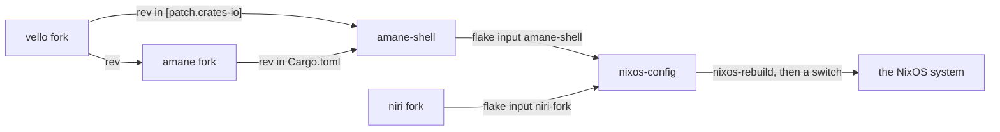

# Releasing a change to the daily machine

How a change in the shell, or in one of its forks, reaches the running desktop: the revisions to
bump, the hashes Nix needs, nixos-config, and the switch. The forks' own routines for following
upstream are in their `maintaining.md` (linked at the end).

## The chain



amane and vello are pinned by the shell, by `rev`. niri is pinned by nixos-config, and the shell
only records the revision it was checked against (`contract.toml`).

## Bumping amane or vello in the shell

Push the fork first (amane's `ocbk`, vello's `ocbk`), then:

1. **The revisions.** Set amane's `rev` in the root `Cargo.toml`'s `[workspace.dependencies]`.
   vello is patched in `[patch.crates-io]` (`vello` and `vello_encoding`). The patch only works
   from the root manifest, so its `rev` must be the one amane's own `Cargo.toml` uses.
2. **The lock.** `cargo update -p amane` (or `-p vello -p vello_encoding`) moves the lock to the
   new revision. Read the lock diff: it may bring other crates along.
3. **The hashes.** `flake.nix` has `cargoLock.outputHashes` with one entry per git checkout, not
   per crate: `amane-0.1.2` and `vello-0.11.0`. Set the bumped one to
   `sha256-AAAAAAAAAAAAAAAAAAAAAAAAAAAAAAAAAAAAAAAAAAA=`, `git add` what changed (Nix only sees
   files git knows about), run `nix build`, and copy the hash it prints after `got:`.
4. **The checks.** `scripts/check-pins` is silent when the local `../amane` checkout matches the pin.
   `cargo xtask contract` checks that amane's and niri's protocol files agree at the pinned
   revisions, and reads `../amane` and `../niri`.
5. **Build and push.** Run the whole set from [CONTRIBUTING](../../CONTRIBUTING.md#before-a-pr), then
   `nix build`, then push.

When amane bumps its vello, both move together: the shell's `[patch.crates-io]` revision, its
`vello-0.11.0` hash, and amane's.

## Bumping niri

niri is built by nixos-config, not by the shell. After pushing niri's `ocbk`:

1. In nixos-config, `nix flake update niri-fork`.
2. In the shell, set `contract.toml` to the same revision; `cargo xtask contract` says when they
   differ.
3. A niri change takes effect at the next login, not at the switch: niri is the session.

## nixos-config and the switch

1. In `~/nixos-config`, `nix flake update amane-shell` once the shell is pushed (`niri-fork`
   for niri).
2. Build: `nixos-rebuild build --flake .#nixos-niri` (the host, as `nixos.json` names it for Shell Settings), which leaves `./result`.
3. Commit and push `flake.lock`.
4. **Back up** what the shell keeps before a switch that changes a file format:

   ```sh
   b=~/amane-shell-backup-$(date +%F-%H%M); mkdir -p "$b" && cp -a ~/.config/amane-shell "$b"/config && cp -a ~/.local/state/amane-shell "$b"/state
   ```

5. **Switch**, without sudo, through the activation helper the system ships:

   ```sh
   systemd-run --wait --pipe --collect $(readlink -f /run/current-system/sw/bin/amane-nixos-activate) switch $(readlink -f result)
   ```

   Shell Settings' System pages do the same: build, compare, then switch
   ([nixos.md](../integration/nixos.md)).

A switch that restarts `amane-shell.service` restarts the bar. Programs started from the dock or
the launcher live in scopes of their own (amane's `Launch`), so they survive it.

### Drop

The flake builds `amane-drop` with the workspace. It wraps Drop, and Shell Settings, with `curl`,
`secret-tool` (libsecret) and `wl-copy` (wl-clipboard) after the system's `PATH`, and installs
`amane-drop.desktop`. nixos-config runs it as its own user unit
([drop.md](../shell/drop.md#installing)). A switch to a system whose shell input doesn't carry
`amane-drop` yet leaves that unit failing to start, and does no other harm.

## The forks' own routines

- amane: [docs/fork/maintaining.md](https://github.com/098765434/amane/blob/ocbk/docs/fork/maintaining.md),
  rebased onto upstream `main`: a reference merge first, then the rebase resolved toward it, then
  a check that every commit builds.
- niri: [docs/fork/maintaining.md](https://github.com/098765434/niri/blob/ocbk/docs/fork/maintaining.md),
  rebased onto upstream's release tags.
- vello: [docs/fork/README.md](https://github.com/098765434/vello/blob/ocbk/docs/fork/README.md#maintaining).

Each keeps its commits from before the last rebase on `ocbk-pre-tidy`, so a shell commit that
pinned an older revision still builds. What the shell relies on from each, and since which
revision, is in [contract.md](../integration/contract.md).
