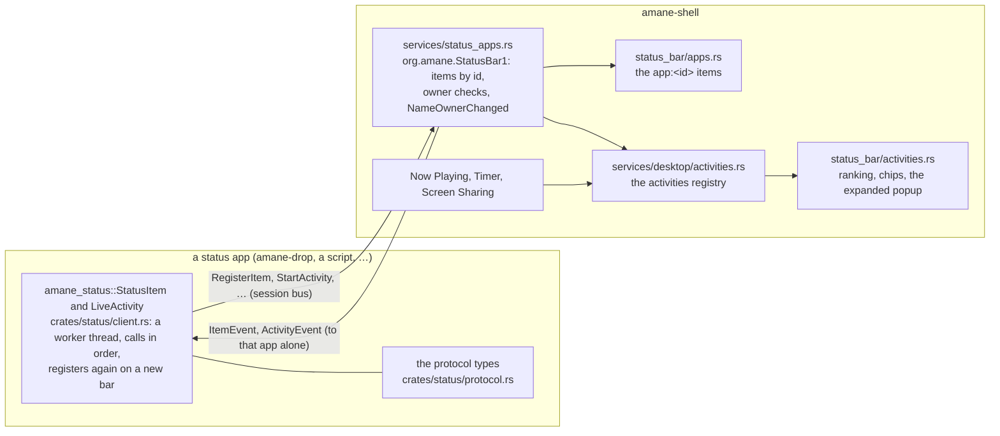

# Status apps, Activities and Drop: how they're built

This page is for working on the framework itself. It explains how the pieces fit across the
three repos, which thread does what, and how to test it all beside a running desktop without
touching the user's clipboard, keyring or phone. To use the framework, see
[writing-a-status-app.md](../integration/writing-a-status-app.md). For what users see, see
[status-bar.md](../shell/status-bar.md#programs-items) and [drop.md](../shell/drop.md).

## The pieces



| Repo | Files | What |
|---|---|---|
| amane-status | `crates/status/src/protocol.rs` | the JSON types (`ItemSpec`, `ItemEvent`, `ActivityContent`, `Trailing`, `Tint`, `Dismiss`…), `encode`/`decode` with clamping and a version check |
| amane-status | `crates/status/src/client.rs` | `StatusItem` and `LiveActivity`: calls in order on amane's control thread (`run_in_order`), events on their own thread, re-registration |
| amane | `src/dbus/bus.rs` | `Bus::emit_to`: a signal to one destination |
| amane | `src/wayland/dropped.rs` | drops read off the event loop (`Drags`, `read_later`, `handle_arrived_drags`), so a slow drag source can't stall the bar |
| amane-phone | `crates/phone/src/kdeconnect/actions.rs` | `share_files_now`, `share_text_now`: KDE Connect sends that wait and report |
| shell | `apps/shell/src/services/status_apps.rs` | the bus server: methods, ownership, introspection, cleanup when a program leaves, the seen list |
| shell | `apps/shell/src/services/desktop/activities.rs` | the activities registry: handles, owners, ending times, `Dismissed`, the 8-hour end |
| shell | `apps/shell/src/surfaces/status_bar/activities.rs` | the built-in sources, ranking, compact and minimal chips, the expanded popup, alerts, its IPC |
| shell | `apps/shell/src/surfaces/status_bar/apps.rs` | programs' items: picture, title, badge, clicks, menus, drops |
| shell | `apps/shell/src/surfaces/status_bar/indicators.rs`, `drag.rs` | `Item::Activities` and `Item::App`, ordering (`items_with`), hiding, and the `media`/`timer` migration |
| kit | `src/platform/settings/` | `StatusBar` (`activities_*`, `status_bar.rs`), `DropGrids`, `DropTile`, `UploadTo`, `DropSharing` (`drop.rs`), and the seen lists (`seen.rs`) |
| kit | `src/platform/secrets.rs` | secrets through `secret-tool`, with a 0600 file as a fallback |
| kit | `src/foundation/icons.rs` | `NAMED` and `named()`: the glyph names an `ItemIcon::Glyph` may use |
| apps | `apps/drop/` | amane-drop: `main.rs`, `state.rs`, `grid.rs`, `tasks.rs`, `files.rs`, `share.rs`, `shared.rs` |
| apps | `apps/settings/src/status_bar.rs`, `drop.rs` | Status Bar › Activities, and the Drop page |
| nixos-config | `home/home.nix`, `niri/config.kdl` | the `amane-drop` user unit, the Mod+Shift+D bind, the `amane.drop` layer rule |

## How things travel

**A click on a program's item.** `apps.rs` sends `Activated { x, output, edge }` through
`status_apps::send`, off the event loop. It goes as a unicast `ItemEvent` to the item's owner.
The client's event thread calls the handler. Drop calls `state::toggle`, which changes its
`Ui` and calls `Changed::changed()`, and its window redraws. `x` comes from where the item was
laid out (`Laid.start` in `drag.rs`), not from a measurement taken at click time.

**Files dragged over an item.** `on_files_over` sends `DragHover { over: true }`. Drop opens its
grid with `by_drag` set: no keyboard, input only on the card. A drop on a tile reaches Drop's own
window directly; the bar is no longer involved. When nothing holds the files for 700 ms, the grid
closes.

**An activity.** `LiveActivity::start` hands back a handle at once. `StartActivity` goes out on
amane's worker, and later updates queue behind it. The bar's registry assigns the real handle,
and the client maps it. The bar draws from the registry each frame, and a countdown ticks through
`motion::redraw_after` without traffic. A button press goes `registry::act`, then the sink, then
an `ActivityEvent` to the owner. `EndActivity` with `After(n)` keeps it dimmed for `n` seconds,
then `Dismissed` is sent.

**The bar restarts.** The client watches `owner_changes("org.amane.StatusBar1")`. When a new
owner appears, it sends every item and activity again and maps the new handles. Drop
doesn't notice. Tested: kill the test shell, start it again, and `status-bar apps list` shows
Drop's item again.

**A program leaves.** The server watches `NameOwnerChanged` for unique names and drops that
program's items and activities (`forget`, `end_all_of`).

## Drop's threads

| Thread | Does | Talks to the window through |
|---|---|---|
| the event loop | draws the grid, handles clicks and drops on it | — |
| the bus event thread (amane's client) | item clicks, drags, menu picks | `state::change` → `Changed` |
| one per task (`tasks::run`) | copying, moving, uploading, sending to the phone | `state::change` for the tile's ring; `LiveActivity::update` for the bar |
| curl's readers (`share::run_curl`) | its answer, and its progress bar on stderr | a channel read every 100 ms, which is also when Cancel is checked |
| `secrets::known` lookups (Settings) | `secret-tool lookup` | `SecretsChanged` |

The grids and accounts are amane `Config`s (`drop_grids()`, `drop_sharing()`), followed live
by Drop and Shell Settings alike. The Drop Bar and Recently Shared are state files that only
Drop writes.

## Testing

Real pointer clicks and drags can't be injected here. Everything else can be driven over IPC,
beside the user's running bar.

### A test bar and Drop, isolated

```sh
T=$(mktemp -d)
mkdir -p $T/config $T/state $T/bin
cp -r ~/.config/amane-shell $T/config/          # then set auto_hide to "never" in status-bar.json
printf '#!/bin/sh\ncat > %s/copied.txt\n' $T > $T/bin/wl-copy   # links land in a file
printf '#!/bin/sh\nexit 1\n' > $T/bin/secret-tool              # secrets go to the 0600 file
chmod +x $T/bin/*
ENV="PATH=$T/bin:$PATH XDG_RUNTIME_DIR=$T WAYLAND_DISPLAY=/run/user/1000/wayland-1 \
     XDG_CONFIG_HOME=$T/config XDG_STATE_HOME=$T/state"
env $ENV PULSE_SERVER=unix:/run/user/1000/pulse/native PIPEWIRE_RUNTIME_DIR=/run/user/1000 \
    ./target/debug/amane-shell &
env $ENV ./target/debug/amane-drop &
```

- **The bus.** The real shell build in use may not serve `org.amane.StatusBar1`, so the test bar
  takes the name on the real session bus. Only one copy can own it.
- **Stopping them.** Find the test processes by the `XDG_RUNTIME_DIR` in `/proc/<pid>/environ`,
  never by name. `pkill -f` on a pattern also matches the shell running the command.
- **Notifications** still reach the real notification server, so set `"notify": false` in the
  test `sharing.json`.

### Driving it

| Want | Command |
|---|---|
| Drop's item is up | `printf 'status-bar\napps\nlist\n' \| nc -U -N $T/amane.sock` |
| Click it | `status-bar apps activate org.amane.drop` |
| Activities going on | `status-bar activities list` |
| Press an activity's button | `status-bar activities press bus.<h> cancel` |
| End one | `status-bar activities end bus.<h>` |
| Open the grid, in edit mode | `printf 'open\n' \| nc -U -N $T/amane-drop.sock`, or `edit` |
| What a drop on tile 2 does | `printf 'run\n2\n/path/file\n' \| nc -U -N $T/amane-drop.sock` |
| Hold files on the Drop Bar | `printf 'hold\n/path/a\n/path/b\n' \| nc -U -N $T/amane-drop.sock` |
| No vello | build with `--features amane/vello-stats`, run with `AMANE_FRAMES=1`: only `vello 0` |

### Uploads without the internet

`AMANE_DROP_0X0_URL` points the 0x0.st tile at a local server, and an S3 account's `endpoint`
can be a local one (`http://127.0.0.1:8737`). A small Python `http.server` that answers a POST
with a URL, and a PUT with 200, is enough to check:
- the multipart form;
- the SigV4 `Authorization` header, `x-amz-content-sha256: UNSIGNED-PAYLOAD`, `x-amz-acl` and
  `Content-Type`;
- the link copied, and Recently Shared.

Make it read a path with `slow` in it slowly, to watch the progress ring and try Cancel.

### Don't

- **Don't run a Send to Phone tile.** If one phone is connected it sends at once, to the user's
  real phone. Test the request with unit tests.
- **Don't use the real `wl-copy` or `secret-tool`** in tests. They write the user's clipboard and
  keyring, and a locked keyring opens a password prompt on their screen.
- **Don't screenshot a window with `niri msg action screenshot-window`.** It always puts the
  picture on the clipboard. `grim -g` on the region works for layer surfaces such as the grid
  and the bar.
- **Crop screenshots** to the card or the bar. The full screen shows whatever the user is
  working on.
- **Don't run `cargo fmt --all` in this repo.** The pinned rustfmt reformats files nobody
  touched. Run `rustfmt --edition 2024` on the files you changed.

### Unit tests

| Where | Covers |
|---|---|
| amane-status `protocol.rs` | round trips, clamping, a newer `v` refused, an empty id refused |
| shell `services/status_apps.rs` | an id belongs to the program that registered it; a bad payload refused |
| shell `services/desktop/activities.rs` | only the owner changes or ends one; ending later; a program leaving; staleness |
| shell `surfaces/status_bar/activities.rs` | countdown and trailing text |
| kit `settings.rs` | `items_with`, the migration, the Drop types read as written, `DropSharing::missing` |
| drop `files.rs` | free names, folders copied whole, no half file after a cancel, replace and keep both, a move on one disk |
| drop `tasks.rs` | Rename & Move's names, what a job says |
| drop `share.rs` | curl's progress bar parsed; secrets on stdin and quoted, never in arguments; SFTP and S3 URLs (AWS and another endpoint); Imgur's checks and its link |
| drop `grid.rs` | the card's size and place; buttons wrapping |
| settings `search.rs` | every page, Drop included, can be found |

`cargo test --workspace` in the shell runs them all.

## Shipping

Like any shell change: [release.md](release.md), which also says how the flake builds and wraps
`amane-drop`.
